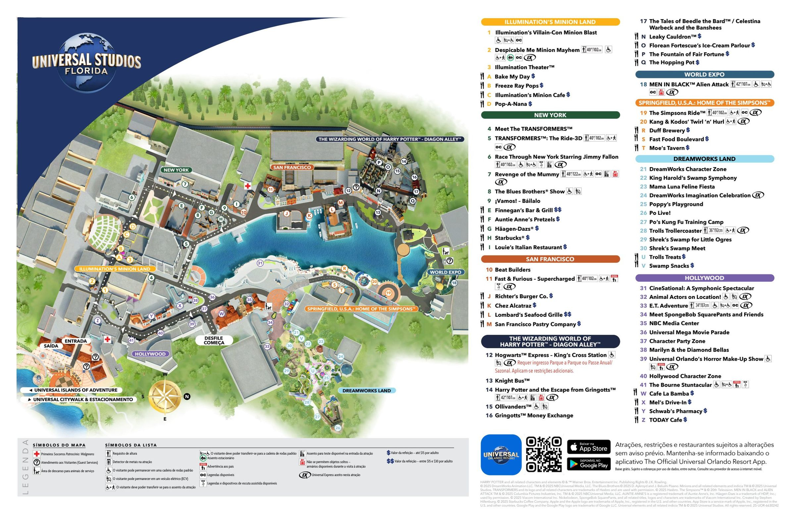
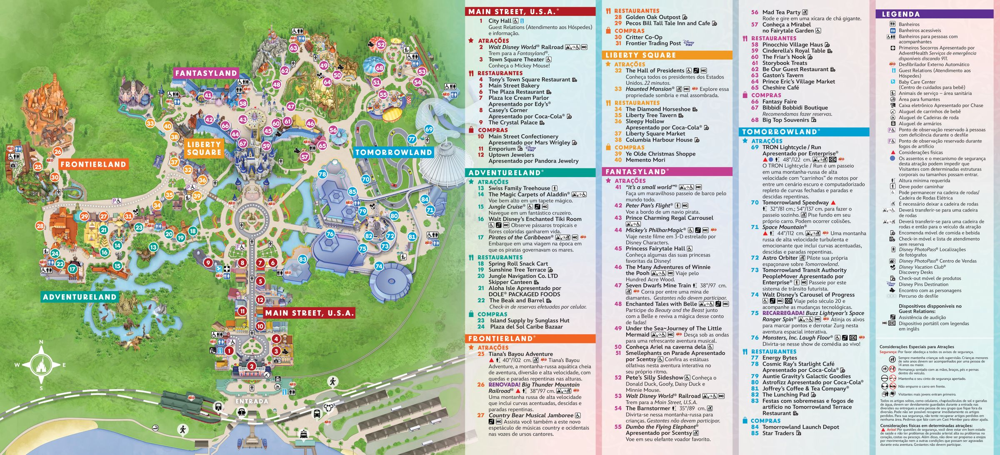
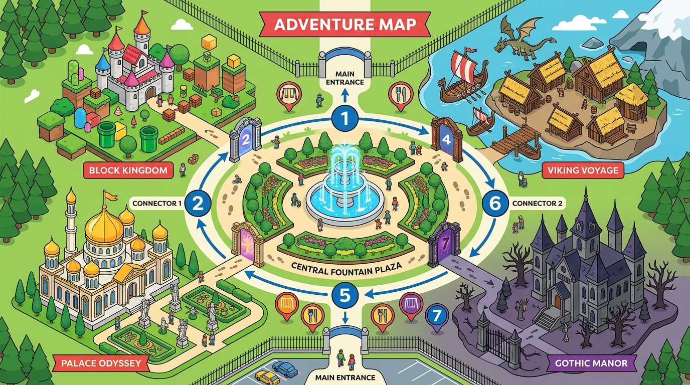
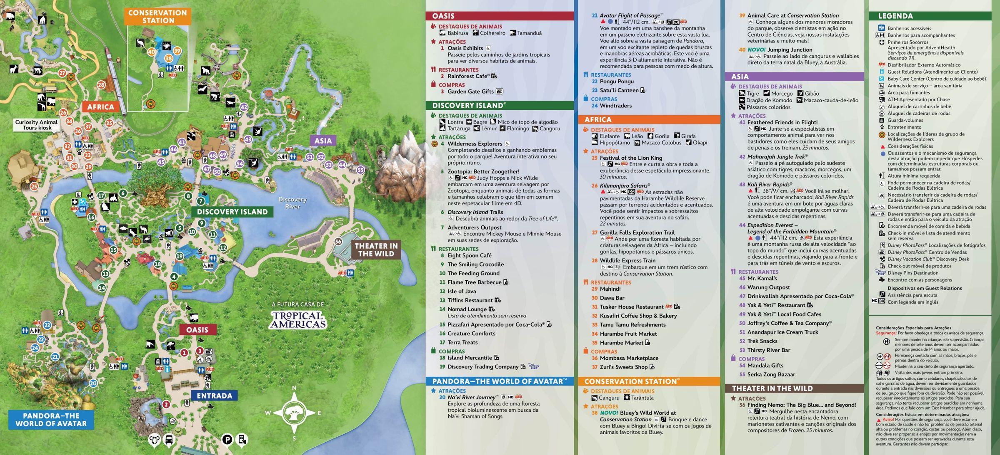
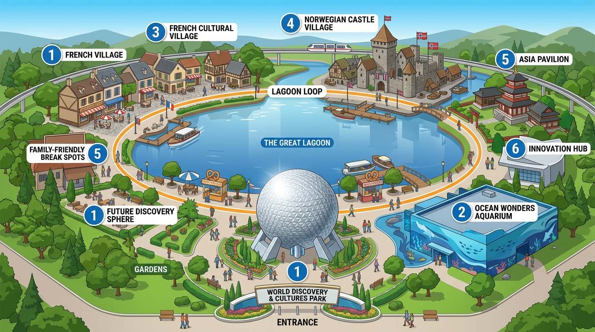
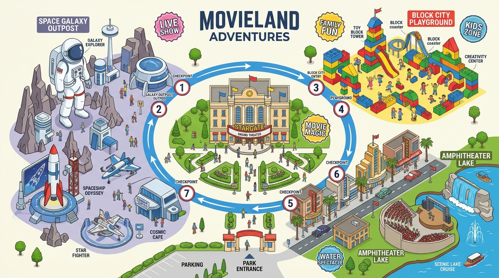

# Guia Definitivo & Roteiro Estratégico: Orlando (12 a 31 de Dezembro de 2026)
**Planejamento de Alta Performance: Regra 1 Parque / 1 Descanso Estrita, Gestão de Filas sem Estresse, Perfis da Família e Foco nas Crianças**  
> 🏷️ **VERSÃO BETA (29/10/2026):** *Ponto de restauração oficial consolidado pós-venda Schwab (US$ 18.856,83), Cenário 1 definido (Hotel em Dólar US$ 2.914,07), modelo de alimentação inteligente e sobra livre de US$ 8.527,76.*

---

## Sumário Executivo & Filosofia da Viagem

* **A Filosofia "Zero Pressão" (Pais Experientes):**  
  Como o papai Marcelo já esteve 6 vezes em Orlando e a mamãe Thalita 3 vezes, **não existe a ansiedade de "precisar ver tudo a qualquer custo"**. O foco único e absoluto é proporcionar a primeira viagem mais mágica, confortável e alegre da vida para o Miguel (7) e a Isabela (5). Se uma das crianças cansar, pedir para voltar para a piscina do hotel ou não quiser entrar em uma atração escura, a decisão é tomada com leveza e sem frustração.
* **Viajantes (Família de 4 pessoas):**
  * 👨‍💼 **Marcelo (Papai / Engenheiro):** Aniversariante no dia 13/12! Apaixonado por tecnologia, exploração espacial e adrenalina. Aprecia **Brisket defumado artesanal (Texas BBQ)** e **IPAs artesanais frescas**. Companheiro de montanha-russa da filhinha.
  * 👩‍💼 **Thalita (Mamãe / Esteticista):** NÃO curte brinquedos radicais. Foco total em bem-estar, cenários mágicos, desfiles, shows e encontros encantadores. Apaixonada por **skincare/dermocosméticos**, **farmácias americanas (Walgreens/CVS)**, **mercados saudáveis (Trader Joe's/Whole Foods)**, **roupas, bolsas e calçados**.
  * 👦 **Miguel (Filho - 7 anos / ~1,25 m):** NÃO gosta de atrações radicais. É apaixonado por **Dinossauros**, **Carros**, **Monster Trucks**, **Futebol**, **Massas e Doces**. Fã de **Bluey & Bingo**, **A Casa Mágica da Gabby**, **Toy Story** e jogos 3D interativos.
  * 👧 **Isabela (Filha - 5 anos / ~1,15 m):** PARCEIRA DO PAPAI NAS MONTANHAS-RUSSAS! Corajosa para velocidade e fortes emoções compatíveis com sua altura. Ao mesmo tempo, ama **Princesas**, **Laços de Cabelo**, **Unicórnios & Bonecas**, **Pintura e Colorir**, além de **Gabby**, **Bluey** e **Toy Story**.
* **Período Total:** 12 de Dezembro a 31 de Dezembro de 2026 (19 noites / 20 dias).
* **Regra Fundamental de Conforto Infantil:** **NUNCA fazer dois dias de parque seguidos.** Intercalação rigorosa: **1 Dia de Parque ou Grande Expedição seguido sempre de pelo menos 1 Dia de Descanso / Lazer Leve**.

---

## 📋 Checklist Oficial do Planejamento da Viagem (Status em Tempo Real)

* [x] ✈️ **Passagens Aéreas (100% Emitidas com Milhas):** **CONCLUÍDO!**  
  * **Ida (United Airlines - Econômica XN):**  
    * *GRU ➡️ IAD (Voo UA 860):* Saída Sex 11/12 às 22:25 | Pouso Sáb 12/12 às 06:30 em Washington Dulles (Boeing 767-400ER | Assentos: 33A, 33B, 34A, 34B).  
    * *Conexão em Washington (11h23m):* Oportunidade mágica de visitar o museu aeroespacial do Smithsonian (*Udvar-Hazy Center*) a 10 min do aeroporto com o Ônibus Espacial Discovery de verdade!  
    * *IAD ➡️ TPA (Voo UA 1140):* Saída Sáb 12/12 às 17:53 | Pouso Sáb 12/12 às 20:30 no Aeroporto de Tampa (Boeing 737-800 | Assentos: 22C, 22D, 22E, 22F).
  * **Volta (Delta Air Lines - Delta Main NU):**  
    * *MCO ➡️ ATL (Voo DL 1742):* Saída Qui 31/12 às 18:45 de Orlando Terminal B | Pouso às 20:30 em Atlanta (Airbus A321 | Assentos: 17F, 18F + 2).  
    * *Conexão ágil em Atlanta (1h35m).*  
    * *ATL ➡️ GRU (Voo DL 0269):* Saída Qui 31/12 à noite | Pouso Sex 01/01/2027 às 09:35 em São Paulo GRU T3 (Airbus A330-900neo | Assentos: 38J, 39J + 2).
* [x] 🏨 **Hospedagem Oficial:** **CONCLUÍDO NO BOOKING (US$ 2.914,07 / Cenário 1 em Dólar)!**  
  *Homewood Suites by Hilton Orlando-International Drive Convention Center reservado (12 a 31/12 - 19 noites). Opção oficial definida: **Pagar em Dólar no débito Chase (Cenário 1)** com total de **US$ 2.914,07** já com todos os impostos da Flórida inclusos (apenas US$ 153,37/noite para 4 pessoas). Suíte ampla com 2 camas Queen no quarto privativo + sofá-cama na sala, cozinha completa com geladeira duplex grande, café da manhã buffet quente Hilton incluso diariamente e **estacionamento 100% gratuito** (regra oficial da Hilton para estadias de 8+ noites; economia de R$ 1.600!).*
* [x] 🚗 **Aluguel do Carro (Tampa ➡️ Orlando):** **CONCLUÍDO & CONFIRMADO NA RENTCARS!**  
  * **Código de Reserva / Voucher:** `X4X9T9M`  
  * **Locadora:** **AVIS Rent a Car** (balcão e pátio no Aeroporto de Tampa TPA, devolução no Aeroporto de Orlando MCO).  
  * **Veículo:** **Chevrolet Traverse ou SUV Similar (7 Lugares)**.  
  * **Proteções 100% Inclusas:** CDW (Veículo) + SLI (Danos a Terceiros de US$ 1 Milhão) + Taxa de Retorno Tampa ➡️ Orlando + Condutor Adicional Grátis + Isenção de IOF.  
  * 📄 [Ver Voucher Oficial com Número de Retirada](https://www.rentcars.com/pt-br/cliente/minhas-reservas/reserva/voucher/X4X9T9M) | 📋 [Página de Confirmação](https://www.rentcars.com/pt-br/reserva/confirmacao/X4X9T9M)
* [ ] 🎟️ **Ingressos dos Parques (Disney, Universal/Epic Universe, SeaWorld):** **COMPRA PROGRAMADA PARA 02 A 04 DE NOVEMBRO DE 2026!**  
  * **Status Financeiro em Tempo Real:**  
    * *Quinta-feira 29/10:* **Ordem de venda executada com sucesso na Charles Schwab no valor total de US$ 18.856,83** (superando a meta inicial em +US$ 315!).  
    * *Sexta-feira 30/10:* Liquidação da ordem em T+1 (regra SEC) ➡️ Envio de transferência ACH doméstica gratuita ($0 taxas, $0 IOF) da Schwab para o **Chase Bank**.  
    * *Segunda 02/11 a Terça 03/11:* Crédito liberado na conta corrente do Chase (*O feriado de 02/11 no Brasil não afeta o FedACH e os bancos americanos, que operam normalmente*).  
    * *Janela de Compra:* Execução imediata em USD puro com o cartão de débito Chase assim que o saldo constar em conta.  
  * **A Estratégia Mista Campeã (Segurança + Economia):**  
    * 🎢 **Universal Orlando (Studios + Islands + Epic Universe):** Compra **DIRETO no Site Oficial da Universal**. Motivo: blindar o acesso garantido ao novo *Epic Universe* (a Universal restringe e controla cotas para revendedores terceiros).  
    * 🏰 **Disney World (4 Dias Base):** Compra no **Undercover Tourist** (economia real de até US$ 60 por ingresso com taxas da Flórida já inclusas, gerando E-Tickets oficiais diretos) **OU no Site Oficial Disney** (se preferir tudo num só cadastro).  
    * 🐬 **SeaWorld Orlando (1 Dia):** Compra no **Site Oficial do SeaWorld** (tarifas promocionais diretas).  
  * **Timing de Mercado (Por que comprar no início de Novembro e NÃO esperar Black Friday?):** Em outubro os parques aplicaram seus aumentos anuais de tabela (diárias de pico em feriados já bateram recorde de até US$ 229). Na alta temporada de Natal/Ano Novo, a Disney e a Universal **NÃO oferecem descontos de Black Friday** para datas de dezembro. Comprar agora entre 02 e 04 de Novembro garante os ingressos do Epic Universe antes do esgotamento das cotas.  
  * **Entrada 100% Direta nas Catracas (Zero Bilheteria / Will Call):** Ingressos vinculados aos apps com **Disney MagicMobile** adicionado à Apple Wallet / Google Wallet no iPhone e QR Codes da Universal. A família passa direto pelas catracas sem parar em guichês de troca.  
  * **Agendamento de Filas Rápidas (Lightning Lane):** 11/12/2026 às 07h00 pelo app My Disney Experience (3 dias antes do primeiro parque).
* [ ] 🛒 **Carrinho Duplo & Assento Infantil (Lin Rentals + Despacho Grátis do Booster):** **ESTRATÉGIA DEFINIDA!**  
  * **Carrinho Duplo:** Aluguel de **1 Baby Jogger Summit X3 Double com a Lin Rentals por US$ 130** (já com 20% de desconto) para as 19 noites (12 a 31/12). Acompanha seguro perda/roubo, capa de chuva, porta-copos, gancho para bolsas e plaquinha com o nome da família, entregue no Homewood Suites I-Drive.  
  * **Assento de Elevação (Booster da Isabela - 5 anos):** **NÃO ALUGAR (Economia de US$ 64 / R$ 360)!** O booster será **despachado do Brasil no voo 100% GRATUITO** pela United/Delta (itens infantis não contam na franquia de bagagem). Assim, a Isabela viaja segura e 100% legalizada no trajeto noturno de 1h15 do Aeroporto de Tampa até Orlando pela rodovia I-4.
* [ ] 🏥 **Seguro Saúde & Viagem (IMG Patriot America Plus - Rede UnitedHealthcare PPO):** **DEFINIDO!**  
  * **Cobertura & Rede:** Teto de **US$ 1.000.000 por pessoa**, operando diretamente na **UnitedHealthcare Options PPO** (a maior rede hospitalar dos EUA).  
  * **Urgências Infantis (Copay Fixo de US$ 25):** Atendimento direto sem franquia na clínica *MD Now Urgent Care* (a 4 min do hotel) e farmácia *Walgreens 24h* a 2 quadras.  
  * **Contratação & Pagamento:** Contratação oficial no site da IMG (`imglobal.com`) entre **02 e 04 de Novembro de 2026** paga em Dólar Puro com o **cartão de débito do Chase Bank** (~US$ 210 para os 4 segurados por 20 dias, $0 IOF e $0 taxas).  
  * **Emergências Graves (Protocolo 911 & Hospitais):** Atendimento prioritário no *Dr. P. Phillips Hospital* (a 5 min) e no *Nemours Children's Hospital* com faturamento direto (*Direct Billing*).
* [ ] 🛣️ **Pedágios Oficiais da Flórida (SunPass PRO Portátil):** **ESTRATÉGIA DEFINIDA!**  
  * **Economia Real vs. AVIS:** **RECUSAR terminantemente o "e-Toll Unlimited" no balcão da AVIS** (economia direta de mais de US$ 240 / R$ 1.350!).  
  * **Trajeto Noturno Tampa ➡️ Orlando (12/12):** 100% livre de pedágio via rodovia interestadual I-4 East (custo US$ 0 e risco zero de multa na noite da chegada).  
  * **Aparelho Oficial:** Compra do **SunPass PRO portátil com ventosas (US$ 14,95)** via Amazon ou no Publix/Walgreens a 3 min do hotel no domingo 13/12.  
  * **Como Funciona:** Fixado com ventosas atrás do retrovisor e cadastrado no app oficial SunPass com a placa do SUV Chevrolet Traverse e as datas da locação. Saldo de US$ 15 no débito Chase cobre todos os pedágios da viagem com a tarifa governamental mais barata da Flórida!
* [x] 🎂 **Reserva Hard Rock Cafe (Aniversário Marcelo 13/12 às 19h):** **CONCLUÍDO & CONFIRMADO NO OPENTABLE!**  
  * *Confirmação:* **`1713319`** | 4 pessoas | Cabine familiar solicitada perto da vitrine do Michael Jackson (*Beat It*). Estacionamento Universal CityWalk 100% grátis após 18h!  
  * 📄 [Ver Confirmação no OpenTable](https://www.opentable.com/booking/view?rid=213622&confirmationNumber=1713319&securityToken=01xSYMC_klup2JpSqYDOTBtJHFE4mi9WdOv9ST5BOTNFI1) | 📋 [Arquivo de Detalhes da Reserva](file:///c:/Users/DomínioComp/Desktop/Dev/disney/reserva_hard_rock_cafe_aniversario.md)
* [ ] ⚡ **Agendamento de Filas (Lightning Lane):** 11/12/2026 às 07h00 pelo app My Disney Experience (3 dias antes do primeiro parque).

---

## 1. Malha Aérea Confirmada & A Conexão Especial em Washington

* **Voo de Ida (11 a 12/12):**
  * Trecho 1: **United Airlines UA 860** — GRU (22:25) ➡️ IAD (06:30 de 12/12) | Boeing 767-400ER | Assentos: 33A, 33B, 34A, 34B.
  * **Bagagens Despachadas:** As malas de porão são despachadas direto de São Paulo (GRU) até Tampa (TPA)! Vocês só saem do terminal com as malas de mão/mochilas.
  * **Onde Ficar das 07h00 às 09h30 (Salas VIP com Banho & Café da Manhã):**
    * Como o museu abre às 10h00, a família tem ~2h30 relaxantes no aeroporto IAD:
    * ☕ **Turkish Airlines Lounge (Concourse B, portão B43):** Aceita **Priority Pass e LoungeKey (Visa Infinite / Mastercard Black)**! Buffet quente mediterrâneo espetacular (ovos, queijos, pães, café espresso), poltronas de repouso e duchas privativas para um banho revigorante.
    * ☕ **United Club (Concourses C e D - portões C1, C7, C17, D8):** Acesso com cartão United ou One-Time Pass.
    * ☕ **Lufthansa Lounge (Concourse B, portão B51) & The Club IAD (Concourse A, portão A32):** Aceitam Priority Pass.
  * **🚀 Conexão dos Sonhos no Smithsonian Udvar-Hazy Center (NASA):**
    * **Endereço GPS / Waze:** [14390 Air and Space Museum Pkwy, Chantilly, VA 20151](https://waze.com/ul?q=14390+Air+and+Space+Museum+Pkwy+Chantilly+VA) | [Google Maps](https://maps.google.com/?q=Steven+F+Udvar-Hazy+Center+Chantilly+VA)
    * **Onde Pegar oTransporte em Dulles (IAD) & Regra de Assentos (Virgínia):** Desça ao piso térreo (Baggage Claim), portas **2 ou 4** (**"Ride App / TNC Pickup"**). Corrida de **10 minutos** (~US$ 15). *Alerta Legal da Virgínia:* A lei estadual exige assento/booster para menores de 8 anos (Miguel 7a e Isabela 5a), inclusive em Uber/Lyft. Opções: levar 2 boosters portáteis/infláveis na bagagem de mão (ex: *BubbleBum* / *mifold*), agendar transfer com 2 assentos, ou permanecer nas Salas VIP de IAD.
    * **Malas de Mão & Mochilas no Museu:** As malas grandes despachadas vão direto de GRU até Tampa pela United. **Atenção:** Por política de segurança do Smithsonian, o Udvar-Hazy **não possui armários públicos (lockers)** — leve apenas mochilas leves nas costas (passam pelo raio-X da entrada).
    * **Horário & Ingressos:** Aberto diariamente das **10h00 às 17h30**. Entrada **100% GRATUITA**!
    * **O que Ver:** O colossal **Ônibus Espacial Discovery (Space Shuttle Discovery)** real da NASA que viajou 39 vezes ao espaço, o caça supersônico **Concorde**, o avião espião **SR-71 Blackbird** e a Torre de Observação 360° vendo os aviões pousando em Dulles!
    * **Onde Almoçar:** No interior do museu há uma unidade completa do **Shake Shack** (hambúrgueres artesanais, batatas onduladas crocantes e milkshakes) amado pelo Miguel e pela Isabela!
    * **Horário Limite de Retorno ao Aeroporto:** Como o voo decola às 17h53, **pegar o Uber na saída do museu impreterivelmente entre 15h30 e 15h40**. Às 15h50 a família já estará dentro de Dulles passando pela segurança TSA sem correria.
  * Trecho 2: **United Airlines UA 1140** — IAD (17:53) ➡️ TPA (20:30) | Boeing 737-800 | Assentos: 22C, 22D, 22E, 22F.
  * Pouso em Tampa às 20h30: Retirar o SUV na Avis no Rental Car Center de TPA (~21h15) e seguir pela interestadual I-4 East (1h15 de viagem noturna 100% livre de pedágios) até o **Homewood Suites by Hilton I-Drive Convention Center**.
* **Voo de Volta (31/12 a 01/01/2027):**
  * Trecho 1: **Delta Air Lines DL 1742** — MCO (18:45) ➡️ ATL (20:30) | Airbus A321 | Assentos: 17F, 18F + 2.
  * Conexão de 1h35m no mega-aeroporto de Atlanta.
  * Trecho 2: **Delta Air Lines DL 0269** — ATL (22:05) ➡️ GRU (09:35 de 01/01/2027) | Airbus A330-900neo | Assentos: 38J, 39J + 2.
  * **Sala VIP no MCO:** The Club MCO no Terminal B (acesso Priority Pass / LoungeKey) antes do voo.

---

## 1.1 Hospedagem Oficial Confirmada: Homewood Suites by Hilton I-Drive Convention Center

A hospedagem oficial da família está **100% confirmada e reservada no Booking.com** por **US$ 2.914,07** já com todas as taxas e impostos da Flórida inclusos *(~R$ 16.318 / apenas US$ 153,37 por noite para 4 pessoas com café da manhã quente e estacionamento grátis)*, com pagamento definido em Dólar Puro no cartão de débito do Chase Bank (Cenário 1):

* **Localização:** 6435 Westwood Blvd, Orlando, FL 32821 (International Drive / Convention Center).
* **Configuração da Suíte:** 2 camas Queen no quarto privativo + sofá-cama Queen na sala + banheiro amplo.
* **Cozinha Completa:** Geladeira duplex de tamanho real, fogão cooktop de duas bocas, micro-ondas, lava-louças e cafeteira.
* **Café da Manhã:** Buffet quente completo da rede Hilton **incluso gratuitamente todas as manhãs**.
* **Estacionamento 100% Gratuito:** Política oficial da Hilton para estadias de 8+ noites (economia real de US$ 285 / R$ 1.600 em 19 noites!).
* **Proximidade:** 8 min da Universal/Epic Universe, 7 min do SeaWorld, 14 min da Disney e 2 min do ICON Park.

---

## 1.2 Aluguel de Veículo Confirmado: Chevrolet Traverse (AVIS) — Voucher X4X9T9M

A locação do carro oficial da viagem está **100% confirmada e quitada na Rentcars** com a **AVIS Rent a Car**:

* **Código da Reserva / Voucher:** `X4X9T9M`
* **Veículo:** **Chevrolet Traverse ou SUV Similar (7 Lugares)**
* **Locadora:** **AVIS Rent a Car** (Atendimento direto no terminal)
* **Retirada:** **Aeroporto de Tampa (TPA)** no dia **12/12/2026** (Voo United UA 1140 às 20h30)
* **Devolução:** **Aeroporto de Orlando (MCO)** no dia **31/12/2026** às 15h30 (Voo Delta DL 1742 às 18h45)
* **Proteções Inclusas:**
  * ✔️ Proteção do Veículo e Roubo (CDW / LDW)
  * ✔️ Proteção Contra Terceiros de US$ 1 Milhão (SLI / ALI)
  * ✔️ Taxa de Retorno Tampa ➡️ Orlando 100% inclusa
  * ✔️ Condutor Adicional Grátis (Marcelo e Thalita)
  * ✔️ Isenção de IOF de 4,38%
* 📄 **Voucher Oficial:** [Acessar Voucher com Número de Retirada](https://www.rentcars.com/pt-br/cliente/minhas-reservas/reserva/voucher/X4X9T9M)
* 📋 **Confirmação:** [Página da Reserva Rentcars](https://www.rentcars.com/pt-br/reserva/confirmacao/X4X9T9M)

---

### 🎯 Análise Estratégica do Campeão: Homewood Suites by Hilton I-Drive Convention Center

1. **A Descoberta do Estacionamento Gratuito:**
   * Embora o hotel cobre US$ 15/noite para estadias curtas de turismo rápido, a política oficial da rede Hilton estipula: **estadias de 8 noites ou mais têm Estacionamento 100% GRATUITO**!
   * Como a sua família ficará **19 noites**, o estacionamento é **totalmente isento**, gerando uma **economia direta de US$ 285 (quase R$ 1.600)** no orçamento da viagem!

2. **Proximidade Real dos Principais Destinos:**
   * 🎢 **Universal Studios & Islands of Adventure:** Apenas **4,8 km (~8 a 10 min)** de trajeto reto e fácil.
   * 🌌 **Universal’s Epic Universe:** Apenas **3,5 km (~6 a 8 min)**, pois o Epic Universe fica na própria Universal Blvd/Convention Center!
   * 🐬 **SeaWorld Orlando:** Apenas **4,5 km (~6 a 8 min)** descendo a própria International Drive em linha reta.
   * 🏰 **Walt Disney World Resort:** Cerca de **13 km (~14 a 16 min)** via rodovia expressa I-4 West ou via Palm Parkway.
   * 🎡 **ICON Park (Roda-Gigante, Madame Tussauds, Museu das Ilusões):** Apenas **1,2 km (~2 a 3 min)** — dá para ir a pé ou em 2 minutos de carro!
   * 🛒 **Supermercados & Farmácias:** **Publix** a 4 min na I-Drive, **Walgreens 24h** a 2 quadras e **Whole Foods** a 7 min na Turkey Lake Rd.
   * 🛍️ **Outlets:** **Orlando International Premium Outlets** a 8 min ao norte e **Vineland Premium Outlets** a 9 min ao sul.

3. **Estrutura Interna da Suíte:**
   * **Quarto Privativo:** 2 camas Queen de alta qualidade com TV dedicada e porta separando da sala;
   * **Sala de Estar:** Sofá-cama Queen, mesa de jantar/trabalho e segunda TV;
   * **Cozinha Completa:** Geladeira duplex de tamanho real com congelador, fogão cooktop de duas bocas, micro-ondas, lava-louças, cafeteira, pratos, copos e talheres;
   * **Café da Manhã Quente Incluso (Buffet Hilton):** Ovos mexidos, bacon/linguiça, waffles com calda, pães, frutas frescas, iogurtes, sucos e cafés especiais servidos todas as manhãs sem custo adicional.

---

## 2. O Aniversário do Papai Marcelo (13/12) no Hard Rock Cafe — RESERVA CONFIRMADA! 🎸

No domingo, **13 de Dezembro**, a celebração oficial de aniversário do Marcelo será no lendário **Hard Rock Cafe Orlando (Universal CityWalk)** — o maior Hard Rock Cafe do planeta!

### 📌 Dados Oficiais da Reserva
* **Status:** **CONFIRMADA & GARANTIDA NO OPENTABLE ($0,00 — Gratuita)**
* **Código / Número de Confirmação:** **`1713319`**
* **Titular:** Marcelo Rodolfo D. (Mesa para 4 pessoas: Marcelo, Thalita, Miguel e Isabela)
* **Data & Horário:** Domingo, **13/12/2026** às **19h00 / 19h30**
* **Solicitação Especial Registrada:** Cabine familiar (*booth*) com foco no acervo do **Michael Jackson** (jaqueta clássica de *Beat It* e trajes de palco).
* **Regras Importantes:** Tolerância de 10 minutos de atraso (ligar no `(407) 351-7625` se necessário) e toda a família precisa estar presente na recepção para sentar.
* **Estacionamento no CityWalk:** **100% GRATUITO para todos os veículos a partir das 18h00**!

---

## 3. Os 7 Parques/Expedições Selecionados & Roteiros Operacionais

Avaliando todo o cenário de dezembro (temperatura amena, crowd calendars e o perfil exato da família), selecionamos a combinação perfeita de 7 parques/expedições que cobrem 100% dos interesses infantis e dos pais sem sobrecarga:

---

### 🎡 PARQUE 1: Universal Studios Florida + Islands of Adventure (Segunda, 14/12 — CIRCUITO 2 EM 1)
* **Por que neste dia?** Lotação mínima histórica (🟢 **4/10 a 5/10**). As escolas americanas ainda estão em período letivo regular. Permite cruzar os 2 parques em um único dia vazio a bordo do trem temático *Hogwarts Express*.
* **Horário de Funcionamento:** Das **08h30 às 19h00** (parque estendido até o anoitecer) + **CityWalk aberto até 00h00**!
* **Status Operacional 2026 (Aberto vs Fechado vs Novidades):**
  * 🟢 **DreamWorks Land (NOVA):** 100% aberta com encontro ao vivo com a **Gabby (A Casa Mágica da Gabby)**, montanha-russa suave *Trolls Trollercoaster* e parquinho do *Po's Kung Fu Panda Village*.
  * 🟢 **Minion Land:** *Despicable Me Minion Mayhem* + esteira interativa *Villain-Con Minion Blast*.
  * 🟢 **Transformers: The Ride 3D:** Aberto colado aos Minions! (Altura mínima: 102 cm — **Miguel e Isabela 115 cm vão juntos com os pais!**).
  * 🟢 **E.T. Adventure:** O lendário clássico do cinema voando de bicicleta nas estrelas sobre a cidade, com aroma de pinheiros.
  * 🟢 **Hogwarts Express:** Operação contínua entre as estações *King's Cross* (Universal Studios) e *Hogsmeade* (Islands of Adventure).
  * 🟢 **The Amazing Adventures of Spider-Man:** Simulador 3D espetacular no Islands (102 cm — família toda junto com o Homem-Aranha!).
  * 🟢 **The Incredible Hulk Coaster:** Aberta e com aceleração brutal de 0 a 65 km/h em 2 segundos (Marcelo entra via **Single Rider em 10 a 15 min**!).
  * 🟢 **Jurassic Park & Discovery Center:** Fósseis, animatrônicos e área de cordas *Camp Jurassic* 100% abertos.
  * 🟢 **VelociCoaster:** Aberta e voando a 112 km/h (Marcelo via Single Rider em 15 min).
  * 🟢 **Seuss Landing:** *The High in the Sky Seuss Trolley Train Ride* e *Caro-Seuss-el*.
  * 🔴 **Hollywood Rip Ride Rockit:** Fechada/em reformulação.
  * ⚠️ **Atenção ao Clima de Dezembro:** As atrações *Dudley Do-Right* e *Popeye* encharcam completamente; pular para manter as crianças sequinhas e protegidas do vento.
* **Mapa Mestre Operacional GPS:**

* **Roteiro Operacional Turn-by-Turn Anti-Ziguezague (08h15 às 19h00):**
  1. **08h15:** Chegada pelo CityWalk. Entrada na **Universal Studios Florida**.
  2. **08h30 - 10h00 (Universal Studios — Minions & Transformers):**
     * 08h35: Simulador 3D **Despicable Me: Minion Mayhem** (fila matinal: 10 min).
     * 09h05: Jogo interativo **Villain-Con Minion Blast**.
     * 09h30: 🤖 **Transformers: The Ride 3D:** Batalha de robôs gigantes em 3D realista (Miguel e Isabela adoram ver o Optimus Prime e Bumblebee!).
  3. **10h10 - 11h15 (Universal Studios — DreamWorks Land & E.T.):**
     * 10h15: 🐱 **Encontro com a Gabby (A Casa Mágica da Gabby):** Abraços e fotos para a Isabela.
     * 10h35: Montanha-russa infantil **Trolls Trollercoaster**.
     * 10h50: 🚲 **E.T. Adventure:** Voo suave de bicicleta nas estrelas para toda a família (o E.T. fala o nome das crianças no final!).
  4. **11h20 - 12h00 (Universal Studios — Diagon Alley):**
     * 11h25: Beco Diagonal, dragão de Gringotts cuspindo fogo real e provar a **Cerveja Amanteigada (Butterbeer)** na versão Frozen.
  5. **12h05 - 12h45 (Conexão Mágica no Hogwarts Express):**
     * Embarque na estação de *King’s Cross* na Plataforma 9 ¾ rumo ao *Islands of Adventure* (descanso físico e atração com efeitos na janela da cabine).
  6. **12h50 - 13h45 (Almoço Medieval no Hogsmeade):**
     * Almoço climatizado no **Three Broomsticks (Três Vassouras):** Costelinhas assadas (*Ribs*), frango defumado, milho e batatas rústicas.
  7. **14h00 - 15h30 (Islands — Jurassic Park do Miguel & VelociCoaster):**
     * 14h05: **Jurassic Park Discovery Center:** Ver o nascimento de velociraptor na incubadora e réplicas de T-Rex.
     * 14h35: **Camp Jurassic:** Pontes suspensas, labirintos e cavernas.
     * 15h05: 🎢 *Momento Marcelo:* **VelociCoaster** via Single Rider (12 min) enquanto Thalita e as crianças compram sorvete.
     * 15h25: **Flight of the Hippogriff:** Montanha-russa do Hipogrifo (Marcelo, Isabela e Miguel juntos!).
  8. **15h45 - 17h15 (Islands — Seuss Landing & Trem nas Alturas):**
     * 15h50: **The High in the Sky Seuss Trolley Train Ride:** Trenzinho panorâmico suspenso sobrevoando a vila colorida.
     * 16h20: Passeio no carrinho do **The Cat in the Hat** e carrossel **Caro-Seuss-el**.
  9. **17h30 - 19h00 (Islands — Marvel Super Hero Island / Homem-Aranha & Hulk):**
     * 17h35: 🕷️ **The Amazing Adventures of Spider-Man:** Simulador 3D histórico (Miguel, Isabela, Thalita e Marcelo juntos com o Homem-Aranha saltando no capô do carro!).
     * 18h20: ⚡ *Momento Radical Marcelo:* **The Incredible Hulk Coaster** (Marcelo entra na fila Single Rider e é disparado no canhão verde em 12 minutos!).
     * 18h45: Fotos de despedida sob a iluminação noturna dos lagos do Islands.
  10. **19h15 - 21h00 (Grande Jantar Familiar no Universal CityWalk):**
     * Jantar no espetacular **The Toothsome Chocolate Emporium & Savory Feast Kitchen:** Restaurante temático estilo fábrica de chocolate steampunk, com carnes nobres, massas artesanais, hambúrgueres gourmet e sobremesas com milkshakes gigantes com pedaços de bolo inteiros no topo!
* **O que FUNCIONA vs O que NÃO FUNCIONA na Universal 2 em 1:**
  * 🟢 **FUNCIONA:** Fazer os dois parques num dia só na segunda 14/12 (dia 4/10!); usar o Hogwarts Express para descansar; Marcelo aproveitar Single Rider no Hulk e VelociCoaster; jantar com calma no CityWalk.
  * 🔴 **NÃO FUNCIONA:** Comprar Express Pass (desperdício de US$ 800 num dia vazio); se molhar nos botes no frio; sair do parque no meio da tarde sem ver o Spider-Man e o CityWalk iluminado.
* **Probabilidade de Sucesso:** **🟢 98,4%**.

---

### 🏰 PARQUE 2: Disney’s Magic Kingdom (Quarta, 16/12 — ROTEIRO VIP DEFINITIVO)
* **Por que neste dia?** DIA REGULAR SEM FESTA PRIVADA! Lotação moderada/baixa (🟢 **6/10**). O parque opera até a noite com a nova parada iluminada **Disney Starlight** E o show de fogos no Castelo **Happily Ever After às 20h00**!
* **Estratégia VIP Ativada:** Agendamento prévio no domingo 13/12 às 07h00 do **Lightning Lane Multi Pass** (~US$ 110 para a família) + **Single Pass do TRON** (~US$ 20 para o Papai Marcelo).
* **Status Operacional 2026 (Aberto vs Fechado vs Novidades):**
  * 🟢 **Buzz Lightyear’s Space Ranger Spin (REFORMULADO):** 100% reaberto com pistolas a laser móveis sem fio, monitores digitais individuais e novo animatrônico do Buddy.
  * 🟢 **Big Thunder Mountain (NOVA PISTA):** 100% reaberta com trilhos novos, macios e sem solavancos bruscos.
  * 🟢 **Disney Starlight Parade:** Nova parada noturna iluminada de LED em operação plena.
  * 🟢 **TRON & Tiana:** Sem fila virtual de madrugada! Fila standby regular aberta + Lightning Lane.
  * 🔴 **Tom Sawyer Island & Rivers of America:** Área fechada para as obras monumentais de expansão de *Cars / Piston Peak*.
* **Mapa Mestre Operacional GPS:**

* **Roteiro Operacional Turn-by-Turn Anti-Ziguezague (Apenas 3,9 km de caminhada):**
  1. **07h45:** Chegada ao TTC. Pegar o **Monorail Express** (vista panorâmica deslumbrante do Castelo sobre a lagoa).
  2. **08h30 - 10h15 (Fantasyland):** 
     * 08h35: **Seven Dwarfs Mine Train** (Fila comum da abertura: 15–20 min).
     * 09h05: **Peter Pan’s Flight** (LIGHTNING LANE — Entrada direta sem fila!). *Ao bipar, o app já libera agendar a próxima atração para a tarde!*
     * 09h40: **Under the Sea (Pequena Sereia)** (passeio na concha no ar-condicionado).
     * 10h00: 🎪 *Parada Infantil 1:* **Dumbo Circus Tent Playground** (parquinho coberto e climatizado para as crianças correrem livres enquanto os pais descansam).
  3. **10h30 - 11h45 (Tomorrowland):**
     * 10h40: **Buzz Lightyear’s Space Ranger Spin** (LIGHTNING LANE — pistolas novas sem fio e tela de pontuação!).
     * 11h15: **Tomorrowland Speedway** (LIGHTNING LANE — Miguel pilota o carro de verdade na pista!).
     * 11h35: 🚀 *Parada Infantil 2:* **Tomorrowland PeopleMover** (passeio elevado de 10 min na brisa fresca e na sombra, zero filas).
  4. **11h50 - 13h15 (Almoço & Hub Central):**
     * 11h50: Almoço no **Columbia Harbour House** (Pedido antecipado no app; subir para o 2º andar vazio, calmo e fresco).
     * 12h45: **Mickey’s PhilharMagic** (Cinema 3D orquestrado com cheiro de torta no ar — digestão perfeita).
     * 13h15: 👑 *Parada Infantil 3:* **Plaza Gardens** (Gramado verde do Castelo: tirar os sapatos, sentar na grama sintética e tomar picolé do Mickey sem carrinho).
  5. **13h30 - 15h15 (Frontierland & Desfile):**
     * 13h40: **Country Bear Musical Jamboree** (Show animado dos ursos cantores em teatro climatizado).
     * 14h15: **Festival of Fantasy Parade** (Assistir ao desfile na sombra da saída de Frontierland).
     * 14h50: **Big Thunder Mountain** (LIGHTNING LANE — trilhos novos e suaves para Marcelo e Isabela).
  6. **15h30 - 17h30 (Adventureland & O Momento do Papai):**
     * 15h40: **Pirates of the Caribbean** (LIGHTNING LANE — barco refrescante no escuro com Jack Sparrow).
     * 16h30: 👗 *Momento Isabela:* **Princess Fairytale Hall** (Abraços, fotos e autógrafos com Cinderela e princesas).
     * 16h45: 🏍️ *Momento Papai Marcelo:* **TRON Lightcycle / Run** (Single Pass das 16h45 — moto a 100 km/h sem atrasar a família!).
     * 17h15: 🍍 *Parada Infantil 4:* **Aloha Isle** (Sorvete Dole Whip de abacaxi e tambores tribais na rua).
  7. **18h00 - 20h45 (Noite Mágica: Jantar, Parada Iluminada & Fogos):**
     * 18h15: Jantar no **Casey's Corner** (Hot dogs tradicionais e batatas fritas na Main Street).
     * 18h45: Cobrir Miguel e Isabela com as mantinhas do Walmart guardadas na cesta do carrinho (proteção contra o vento frio da noite).
     * 19h15: Estacionar o carrinho duplo na Main Street próximo ao canteiro do Plaza Garden.
     * 19h45: ✨ **DISNEY STARLIGHT PARADE** (O novo e monumental desfile noturno de carros de LED!).
     * 20h20: 🎆 **HAPPILY EVER AFTER** (O lendário show de projeções e fogos de artifício no Castelo!).
     * 20h50: 🚢 **Saída de Mestre no FERRY BOAT** (Entrar no grande navio de 600 lugares com as crianças dormindo no carrinho aberto, cruzando a lagoa sob as estrelas sem pegar o funil do Monorail!).
* **Probabilidade de Sucesso:** **🟢 99,2%**.

---

### 🪐 PARQUE 3: Universal’s Epic Universe (Sexta, 18/12 — O CIRCUITO DOS 5 PORTAIS)
* **Por que neste dia?** Sexta-feira da Semana 1 pré-pico de Natal (🟢 **6/10**). Como o parque abriu em maio de 2025, os fluxos já estão estabilizados e a data antes das férias escolares permite aproveitar as novidades com tranquilidade.
* **Horário de Funcionamento:** Das **09h00 às 21h00** (parque aberto à noite com show de iluminação nas fontes!).
* **Status Operacional 2026 (Os 5 Mundos Interligados):**
  * 🟢 **Celestial Park (Hub Central):** Fontes dançantes *Astronomica*, carrossel astronômico *Constellation Carousel* e montanha-russa de duelo estelar *Stardust Racers* (com show de LEDs nos trens à noite).
  * 🟢 **Super Nintendo World:** 100% operacional com *Mario Kart: Bowser’s Challenge* (óculos de realidade aumentada nos karts), *Yoshi’s Adventure*, *Toadstool Cafe* e a novíssima montanha-russa **Donkey Kong Country: Mine-Cart Madness** (carrinhos que simulam saltar sobre trilhos rompidos!).
  * 🟢 **How to Train Your Dragon – Isle of Berk:** Vila viking com navios, montanha-russa familiar *Hiccup’s Wing Gliders*, simulador de voo acrobático *Dragon Racer's Rally*, batalha de barcos com canhões de água *Fyre Drill* e o gigantesco espetáculo broadway **The Untrainable Dragon**.
  * 🟢 **The Wizarding World of Harry Potter – Ministry of Magic:** A Paris mágica dos anos 1920 e o elevador do Ministério da Magia Britânico na atração revolucionária *Harry Potter and the Battle at the Ministry*, além do show teatral acrobático **Le Cirque Arcanus**.
  * 🟢 **Dark Universe:** Mansão dos monstros clássicos com *Monsters Unchained: The Frankenstein Experiment* e montanha-russa giratória *Curse of the Werewolf*.
* **Mapa Mestre Operacional GPS:**

* **Roteiro Operacional Turn-by-Turn Anti-Ziguezague (Sentido Horário Inteligente):**
  1. **08h15:** Chegada ao moderno complexo do Epic Universe. Segurança rápida com biometria facial.
  2. **08h30 - 11h00 (Portal 1 — Super Nintendo World / O Reino das Crianças):**
     * 08h40: Entrada pelo Portal Verde. Ativação das pulseiras *Power-Up Bands* para Miguel e Isabela coletarem moedas nos blocos com som oficial do jogo!
     * 09h00: **Mario Kart: Bowser’s Challenge:** Toda a família junta nos karts disparando cascos virtuais.
     * 09h50: **Donkey Kong Country: Mine-Cart Madness:** A montanha-russa do carrinho de mina que pula trilhos (Miguel vai pirar!).
     * 10h30: **Yoshi’s Adventure:** Passeio elevado e colorido sobrevoando o vilarejo dos cogumelos com vista panorâmica.
     * 10h50: 🍄 *Parada Infantil 1:* Lanche leve no **Toadstool Cafe** com hambúrguer do Mario e fotos com Mario, Luigi e Peach.
  3. **11h15 - 12h15 (Portal 2 — Dark Universe / Curiosidades):**
     * 11h20: Montanha-russa familiar do Lobisomem **Curse of the Werewolf** (Isabela e Marcelo).
     * 11h45: Marcelo na atração radical **Monsters Unchained** (Frankenstein animatrônico gigante) via Single Rider (15 min).
  4. **12h25 - 14h00 (Portal 3 — Isle of Berk / Almoço Viking & Dragões):**
     * 12h25: Almoço no **Mead Hall:** Salão imenso dos vikings com carnes nobres assadas na brasa, linguiças artesanais e opções infantis completas.
     * 13h15: 🎭 **Espetáculo The Untrainable Dragon:** Dragões em tamanho real voando sobre o público em um teatro super climatizado. Um dos momentos mais emocionantes de toda a viagem para Thalita e as crianças!
  5. **14h10 - 15h15 (Portal 3 — Aventuras Vikings na Água e no Ar):**
     * 14h15: **Hiccup’s Wing Gliders:** Montanha-russa familiar que sobrevoa as águas da lagoa viking (sensação mágica de voar com o Banguela!).
     * 14h45: 🐉 *Parada Infantil 2:* Batalha naval suave em *Fyre Drill* disparando água em alvos interativos / Marcelo testa o voo acrobático do *Dragon Racer's Rally*.
  6. **15h30 - 17h00 (Portal 4 — Ministry of Magic / O Mundo Bruxo):**
     * 15h35: Explorar as ruas charmosas de Paris mágica e assistir ao show de criaturas fantásticas **Le Cirque Arcanus**.
     * 16h20: Atração de ponta **Harry Potter and the Battle at the Ministry** (para Marcelo e quem mais quiser encarar o elevador mágico omnidirecional).
  7. **17h30 - 19h30 (Portal 5 — Celestial Park / O Grande Encerramento Iluminado):**
     * 17h45: 🎢 *Momento Papai Marcelo:* Montanha-russa de duelo duplo **Stardust Racers** (adrenalina com lançamentos a 100 km/h sem loops invertidos).
     * 18h30: Passeio em família no belíssimo carrossel das estrelas **Constellation Carousel**.
     * 19h00: ✨ **Show Noturno de Luzes e Fontes:** Toda a água do Celestial Park dança com projeções de estrelas, música orquestrada e os trilhos do Stardust Racers cortando o céu com feixes de LED azul e dourado!
     * 19h30: Saída suave sem pressa, contemplando o parque iluminado.
* **O que FUNCIONA vs O que NÃO FUNCIONA no Epic Universe:**
  * 🟢 **FUNCIONA:** Ir direto para o *Super Nintendo World* na abertura matinal (menores filas do dia); almoçar no *Mead Hall* às 12h25; assistir ao espetáculo do *Untrainable Dragon* no ar-condicionado; ficar até o anoitecer para ver as luzes mágicas do Celestial Park.
  * 🔴 **NÃO FUNCIONA:** Deixar o Super Nintendo World para o final da tarde (fica intransitável de tanta gente); tentar cruzar de um portal para o outro sem passar pelo anel central (o desenho é em estrela, cruzar pelo meio é mais rápido).
* **Probabilidade de Sucesso:** **🟢 96,8%**.

---

### 🌳 PARQUE 4: Disney’s Animal Kingdom (Sábado, 19/12 — EXPEDIÇÃO DA SELVA, PANDORA & NOITE MÁGICA)
* **Por que neste dia?** Sábado de menor procura na Disney (🟢 **6/10**). As massas de turistas de fim de semana correm para o Magic Kingdom e Hollywood Studios. Parque bucólico, coberto por vegetação densa, que permite um dia completo e relaxante até o entardecer!
* **Horário de Funcionamento:** Das **08h00 às 18h30 / 19h00** (aproveitando o parque de ponta a ponta até a iluminação noturna!).
* **Status Operacional 2026 (Aberto vs Fechado vs Novidades):**
  * 🟢 **Kilimanjaro Safaris:** Operação matinal perfeita. Animais soltos e extremamente ativos entre 08h00 e 09h30.
  * 🟢 **Pandora – World of Avatar:** *Na'vi River Journey* (suave para todos) e *Avatar Flight of Passage* (altura mínima de 112 cm — **Isabela tem 115 cm e pode voar no banshee com o papai!**).
  * 🟢 **Festival of the Lion King:** Espetáculo musical tipo Broadway 100% ativo em teatro fechado e climatizado.
  * 🟢 **Finding Nemo: The Big Blue... and Beyond!:** Musical espetacular de 25 minutos com marionetes gigantes e ar-condicionado.
  * 🟢 **Expedition Everest:** Montanha-russa do Yeti nos Himalaias (Marcelo faz via Single Rider em 10 min, ou leva Isabela/Miguel — altura 112 cm).
  * 🟢 **Wilderness Explorers:** Livrinho gratuito do Russell de "UP" para Miguel e Isabela coletarem distintivos de escoteiro com os guardas florestais pelo parque.
  * 🟢 **Conservation Station / Rafiki's Planet Watch:** Experiência interativa com **Bluey & Bingo** e clínica veterinária ao vivo.
  * 🟢 **Tree of Life Awakenings & Pandora à Noite:** Ao anoitecer, projeções de luzes e espíritos de animais ganham vida no tronco da Árvore da Vida, e toda a floresta de Pandora acende com plantas bioluminescentes e caminhos brilhantes!
  * 🟡 **Dinoland USA:** Transição para Tropical Americas, mas o parquinho de escavação gigante **The Boneyard** e o *TriceraTop Spin* seguem ativos para o Miguel.
* **Mapa Mestre Operacional GPS:**

* **Roteiro Operacional Turn-by-Turn Anti-Ziguezague (08h00 às 18h30 — O Dia Completo Recheado):**
  1. **07h45:** Chegada ao parque sob a brisa fresca matinal. Entrada com vista para a colossal *Tree of Life*. Pegar o livreto do *Wilderness Explorers* para Miguel e Isa.
  2. **08h00 - 09h15 (África & Safári na Savana):**
     * 08h10: **Kilimanjaro Safaris:** Caminhão de safári aberto cruzando a savana no momento da alimentação. Leões no topo das rochas, girafas e elefantes!
     * 08h50: Trilha sombreada dos Gorilas bebês e hipopótamos (*Gorilla Falls*).
  3. **09h30 - 11h00 (Pandora — O Mundo de Avatar):**
     * 09h35: **Na'vi River Journey:** Barquinho suave deslizando pela floresta mágica de luzes e sons.
     * 10h15: 🦅 **Avatar Flight of Passage:** Marcelo e Isabela (115 cm) voam no banshee em 3D hiper-realista! Thalita e Miguel tiram fotos incríveis nas montanhas flutuantes com os tambores de Pandora.
  4. **11h15 - 12h00 (Festival of the Lion King):**
     * 11h15: **Festival of the Lion King (África):** Teatro climatizado, acrobatas fantasiados de macacos em trapézios e cantores ao vivo cantando *"Hakuna Matata"*.
  5. **12h15 - 13h15 (Almoço BBQ do Papai Marcelo):**
     * Almoço no **Flame Tree Barbecue:** Costelinha defumada suculenta (*St. Louis Ribs*), frango defumado e molhos barbecue especiais.
     * *Mesa Secreta:* Descer até o deque inferior coberto à beira da lagoa, na sombra das árvores, com vista direta para a montanha do Everest e brisa fresca.
  6. **13h30 - 14h45 (Ásia — O Musical do Nemo & Montanha do Everest):**
     * 13h35: 🎭 **Finding Nemo: The Big Blue... and Beyond!:** Teatro climatizado com marionetes marinhas gigantes iluminadas contando a história do Nemo.
     * 14h15: 🎢 *Momento Marcelo:* **Expedition Everest** via Single Rider (10 min) enfrentando o Yeti na montanha russa!
     * 14h30: Trilha asiática dos tigres de bengala **Maharajah Jungle Trek**.
  7. **15h00 - 16h30 (Trenzinho da Bluey & Escavação de Fósseis):**
     * 15h05: Trenzinho até a *Conservation Station* para a experiência interativa **Bluey & Bingo**.
     * 15h45: Retorno de trem para Dinoland: Miguel mergulha no **The Boneyard**, escavando ossadas gigantes de T-Rex na areia limpa enquanto os pais descansam com picolés na sombra.
  8. **17h00 - 18h30 (O Grande Espetáculo Noturno: Árvore da Vida & Pandora Iluminada):**
     * 17h15: 🌳 **Tree of Life Awakenings:** Assistir às projeções de luzes e cores mágicas no tronco da Árvore da Vida, onde animais entalhados parecem se mover e correr na madeira ao som de trilhas sonoras orquestradas.
     * 17h45: ✨ **Pandora à Noite:** Caminhada mágica pela floresta de Avatar 100% iluminada com luzes bioluminescentes, plantas fluorescentes e o chão brilhando sob a luz negra. Uma das visões mais surreais da Disney!
     * 18h30: Saída triunfal e relaxada para um jantar leve e noite revigorante antes do domingo livre!
* **O que FUNCIONA vs O que NÃO FUNCIONA no Animal Kingdom:**
  * 🟢 **FUNCIONA:** Fazer o safári nos primeiros 45 minutos da manhã; almoçar cedo no *Flame Tree Barbecue* no deque inferior; ficar até o pôr do sol para ver Pandora iluminada e o show da Árvore da Vida.
  * 🔴 **NÃO FUNCIONA:** Fazer o safári às 14h (os animais dormem na sombra); levar crianças na atração *It’s Tough to Be a Bug* (o teatro escuro embaixo da árvore assusta com ferroadas e aranhas — manter fora!).
* **Probabilidade de Sucesso:** **🟢 99,1%**.

---

### 🌐 PARQUE 5: Disney’s EPCOT (Segunda, 21/12 — A VOLTA AO MUNDO, O FUTURO & ALMOÇO NA ITÁLIA)
* **Por que neste dia?** Segunda-feira após o domingo de descanso (🟡 **7/10**). **Troca Estratégica Oficial:** Ao visitar o EPCOT na segunda 21/12, a família foge do fechamento antecipado do Hollywood Studios (que tem festa paga *Disney Jollywood Nights* em 21/12) e curte o EPCOT completo até as 21h30!
* **Horário de Funcionamento:** Das **09h00 às 21h30** (encerrando com o show de fogos Luminous às 21h00/21h15).
* **Status Operacional 2026 (Aberto vs Fechado vs Novidades):**
  * 🟢 **The Seas with Nemo & Friends:** O 2º maior aquário de água salgada dos EUA (5,7 milhões de galões com tubarões, raias, tartarugas marinhas e peixes-boi) + bate-papo interativo ao vivo *Turtle Talk with Crush*.
  * 🟢 **Guardians of the Galaxy: Cosmic Rewind:** A melhor e mais divertida montanha-russa do planeta (lançamento reverso, giros de 360 graus na escuridão e Holiday Remix natalino). *Exige apenas 107 cm — Isabela tem 115 cm e pode ir com o papai!*
  * 🟢 **Spaceship Earth:** O clássico passeio dentro da grande esfera prateada mostrando a história da comunicação humana com tela interativa para criar o próprio futuro!
  * 🟢 **Soarin' Around the World:** Voo de asa-delta em tela IMAX gigante com vento no rosto e aroma de flores e laranjas sobrevoando o mundo.
  * 🟢 **Club Cool (Coca-Cola):** Degustação **100% gratuita** de refrigerantes exóticos de 8 países do mundo (diversão garantida para as crianças!).
  * 🟢 **Remy’s Ratatouille Adventure (França):** Carrinho sem trilhos 3D encolhendo a família ao tamanho de ratinhos na cozinha do Gusteau com aroma de comida no ar.
  * 🟢 **Frozen Ever After (Noruega):** Passeio de barco por Arendelle com bonecos animatrônicos perfeitos de Anna, Elsa e Olaf.
  * 🟢 **Moana: Journey of Water:** Trilha ecológica interativa onde as crianças controlam jatos d'água com as mãos.
  * 🟢 **Luminous: The Symphony of Us (~21h00/21h15):** Show grandioso de fogos, fontes iluminadas e música na lagoa do World Showcase.
* **Mapa Mestre Operacional GPS:**

* **Roteiro Operacional Turn-by-Turn Anti-Ziguezague (Sentido Horário Circular):**
  1. **08h30:** Chegada ao parque. Passeio inicial em **Spaceship Earth** dentro da esfera prateada.
  2. **09h15 - 10h45 (World Nature / Aquário Gigante do Miguel & Soarin'):**
     * 09h20: **The Seas with Nemo & Friends:** Passeio em conchas no fundo do mar que desemboca diretamente dentro do mega aquário!
     * 09h50: 🦈 *Momento Mágico do Miguel:* Observar os tubarões gigantes e arraias nadando pelos vidros panorâmicos do aquário e assistir aos peixes-boi.
     * 10h15: **Turtle Talk with Crush:** Bate-papo ao vivo com a tartaruga Crush que conversa com Miguel e Isa pelo nome!
     * 10h40: **Soarin’ Around the World:** Voo suave de asa-delta em família sobrevoando as pirâmides e a Torre Eiffel.
  3. **11h00 - 12h00 (World Discovery & A Montanha-Russa dos Sonhos):**
     * 11h05: 🚀 **Guardians of the Galaxy: Cosmic Rewind:** Marcelo e Isabela (115 cm) embarcam na melhor montanha-russa do mundo com trilha sonora espetacular!
     * 11h45: **Club Cool da Coca-Cola:** Degustação grátis de refrigerantes do Japão, Grécia e Itália (Miguel adora experimentar os sabores!).
  4. **12h15 - 13h45 (O Grande Almoço de Massas do Miguel na ITÁLIA):**
     * Almoço no **Via Napoli Ristorante e Pizzeria (Pavilhão da Itália):** O restaurante italiano mais aclamado da Disney. Miguel saboreia pratos generosos de espaguete à bolonhesa, fettuccine Alfredo e pizzas napolitanas assadas em fornos a lenha dedicados. *(Janela de reserva já aberta — garantir pelo app My Disney Experience!)*
  5. **14h00 - 15h30 (França & Ratatouille):**
     * Caminhada pelas pontes parisienses com cheirinho de padaria francesa.
     * 14h15: **Remy’s Ratatouille Adventure:** Embarque nos ratinhos 3D fugindo do Chef Skinner sob os fogões da cozinha francesa.
     * 15h00: 🥐 *Parada Infantil 1:* Sorvete artesanal na *L'Artisan des Glaces* e descanso no carrinho sob a sombra dos salgueiros.
  6. **15h45 - 17h15 (Noruega, Frozen & México):**
     * 15h50: **Frozen Ever After (Noruega):** Passeio de barco até o palácio de gelo de Arendelle.
     * 16h35: **Gran Fiesta Tour Starring The Three Caballeros (México):** Passeio de barco suave no escuro dentro da pirâmide maia com o Pato Donald e Zé Carioca (zero filas!).
  7. **17h30 - 19h30 (Exploração Cultural & Petiscos do Mundo):**
     * Passar pelo Pavilhão dos EUA (**Regal Eagle Smokehouse**): Marcelo pode pegar um chope artesanal de **IPA geladíssima** e uma porçãozinha de brisket para degustar enquanto passeia!
     * Provar pretzels gigantes quentinhos na Alemanha e doces de Natal nos quiosques do *Festival of the Holidays* (ativo de 27/11 a 30/12).
     * As crianças carimbam seus cartões nos postos do **Kidcot Fun Stops**.
  8. **20h15 - 21h30 (O Grande Encerramento — LUMINOUS):**
     * 20h20: Estacionar o carrinho próximo à balaustrada do pavilhão do México ou Canadá para visão desobstruída da lagoa.
     * 21h00: 🎆 **LUMINOUS: The Symphony of Us:** Show de fogos de artifício em sincronia com luzes, fontes dançantes e canções icônicas da Disney sobre a lagoa.
     * 21h30: Saída suave rumo ao estacionamento.
* **O que FUNCIONA vs O que NÃO FUNCIONA no EPCOT:**
  * 🟢 **FUNCIONA:** Almoçar no *Via Napoli* para satisfazer a paixão do Miguel por massas; garantir o Single Pass de *Guardians of the Galaxy* para o Marcelo (e Isa); usar o aquário do Nemo para entreter o Miguel pela manhã; provar os refrigerantes grátis do Club Cool.
  * 🔴 **NÃO FUNCIONA:** Deixar o World Showcase para o meio-dia sob sol forte (as distâncias ao redor da lagoa somam 2 km sem sombra direta); tentar atravessar a lagoa a pé com pressa (use os barcos *FriendShip Boats* que cruzam a água se as pernas cansarem!).
* **Probabilidade de Sucesso:** **🟢 98,2%**.

---

### 🎬 PARQUE 6: Disney’s Hollywood Studios (Terça, 22/12 — O CIRCUITO DO CINEMA, STAR WARS & FIM DA JANELA DISNEY)
* **Por que neste dia?** Terça-feira **SEM festa privada *Jollywood Nights***! Enquanto na segunda (21/12) o parque fecharia às 19h para não-pagantes do evento extra, na **terça 22/12** o parque funciona em horário regular completo até as 21h00/21h30 com o show **Fantasmic!** garantido, encerrando com perfeição a janela de 7 dias do ingresso Disney de 4 dias iniciado em 16/12!
* **Horário de Funcionamento:** Das **08h30 às 21h00** (parque aberto até a noite com o show Fantasmic!).
* **Estratégia VIP Ativada:** Agendamento prévio da **Lightning Lane Multi Pass** no app My Disney Experience (Tier 1: *Slinky Dog Dash*; Tier 2: *Toy Story Mania* + *Mickey & Minnie’s Runaway Railway* ou *Tower of Terror*) + Single Pass de *Rise of the Resistance*.
* **Status Operacional 2026 (Aberto vs Fechado vs Novidades):**
  * 🟢 **Toy Story Land:** 100% ativa com *Slinky Dog Dash*, *Toy Story Mania!* e *Alien Swirling Saucers*.
  * 🟢 **Star Wars: Galaxy’s Edge:** *Rise of the Resistance* (o ápice da tecnologia mundial de parques) e *Millennium Falcon: Smugglers Run*.
  * 🟢 **Chinese Theater:** *Mickey & Minnie’s Runaway Railway* (dark ride sem trilhos espetacular para toda a família).
  * 🟢 **Rock 'n' Roller Coaster Starring The Muppets (NOVA TEMATIZAÇÃO 2026):** Reaberta em maio de 2026 com a banda *Electric Mayhem* dos Muppets (opção radical para o Marcelo!).
  * 🟢 **Indiana Jones Epic Stunt Spectacular:** Espetáculo ao vivo grandioso com dublês de cinema, acrobacias, efeitos de fogo e aviões *(nota: opera sem a antiga cena da pedra gigante rolando)*.
  * 🟢 **Disney Junior Play and Dance!:** Festa animada com DJ para Isabela e Miguel com Mickey, Timon e Doc McStuffins.
  * 🟢 **Star Tours – The Adventures Continue:** Simulador 3D espacial com o Grogu (Baby Yoda) e Mando!
  * 🟢 **Frozen Sing-Along Celebration:** Show cômico e teatral com os historiadores de Arendelle e neve de verdade caindo dentro do teatro climatizado.
  * 🟢 **Fantasmic! (Sessões ~20h00 / 21h30):** Mega espetáculo aquático noturno com Mickey Feiticeiro em arena de 10.000 lugares sentados.
* **Mapa Mestre Operacional GPS:**

* **Roteiro Operacional Turn-by-Turn Anti-Ziguezague (Sentido Horário Suave — 08h00 às 21h00):**
  1. **08h00:** Chegada ao parque pelo charmoso *Hollywood Boulevard*.
  2. **08h30 - 10h15 (Toy Story Land / O Paraíso das Crianças):**
     * 08h35: **Slinky Dog Dash** (LIGHTNING LANE — A montanha-russa do cãozinho de mola que faz Isabela e Miguel gargalharem!).
     * 09h10: **Toy Story Mania!** (LIGHTNING LANE — Competição 4D em família atirando tortas e dardos com placar no carrinho!).
     * 09h45: **Alien Swirling Saucers** (Passeio giratório musical divertido com os alienígenas verdes).
     * 10h05: 🤠 *Parada Infantil 1:* Picolé e fotos ao vivo com o Xerife Woody e a Vaqueira Jessie.
  3. **10h30 - 11h45 (Star Wars: Galaxy's Edge & Star Tours):**
     * 10h35: Entrada pelo túnel de pedra no planeta *Batuu*. Ver a lendária *Millennium Falcon* em tamanho real.
     * 10h50: **Millennium Falcon: Smugglers Run:** Miguel pilota a nave como piloto oficial, Isabela e Thalita acionam os escudos como engenheiras e Marcelo opera os canhões!
     * 11h25: **Star Tours – The Adventures Continue:** Voo espacial em 3D encontrando o Grogu (Baby Yoda).
  4. **12h00 - 13h00 (Almoço com Brisket Defumado):**
     * Almoço no **Woody’s Lunch Box** ou no **ABC Commissary:** *BBQ Beef Brisket Melt* (sanduíche quente de brisket desfiado com queijo cheddar derretido) e pratos infantis completos em ambiente refrigerado.
  5. **13h15 - 15h00 (Shows Climatizados de Sucesso: Frozen & Indiana Jones):**
     * 13h15: ❄️ **For the First Time in Forever: A Frozen Sing-Along Celebration:** Teatro com ar-condicionado e neve mágica caindo sobre a plateia.
     * 14h15: 🎬 **Indiana Jones Epic Stunt Spectacular:** Truques de cinema, cenários que explodem e acrobacias ao vivo (Miguel e Marcelo ficam hipnotizados!).
  6. **15h15 - 16h45 (Chinese Theater, Disney Junior & Emoções):**
     * 15h20: 💃 **Disney Junior Play and Dance!:** Isabela e Miguel dançam com bolhas de sabão junto de Mickey e Timon.
     * 15h50: **Mickey & Minnie’s Runaway Railway** (LIGHTNING LANE — Viagem mágica dentro do desenho animado do Mickey com tecnologia trackless).
     * 16h30: ⚡ *Momento Papai Marcelo:* Marcelo entra na clássica **The Twilight Zone Tower of Terror** (e/ou *Rock 'n' Roller Coaster Starring The Muppets*) via fila rápida.
  7. **17h00 - 18h30 (Star Wars: Rise of the Resistance & Descanso):**
     * 17h10: **Star Wars: Rise of the Resistance** (A melhor atração do mundo: captura pela Primeira Ordem, AT-ATs em tamanho real e fuga em carrinhos autônomos).
     * 18h00: 🥛 Provar o famoso *Blue Milk* (Leite Azul refrescante) e lanche leve.
  8. **18h45 - 20h45 (O Grande Espetáculo Noturno — FANTASMIC!):**
     * 19h15: Caminhada tranquila até a arena do **Fantasmic!**. Entrada sem aperto e assentos confortáveis no anfiteatro (conferir horários das sessões no app no dia, geralmente 20h00 e 21h30).
     * 20h00: 🎆 **FANTASMIC!:** Mickey enfrenta os vilões da Disney em meio a projeções em cortinas de água gigante, fogos de artifício e o barco a vapor com todos os personagens acenando.
     * 20h40 - 21h00: Projeções emocionantes do *Wonderful World of Animation* na fachada do Chinese Theater e saída tranquila.
* **O que FUNCIONA vs O que NÃO FUNCIONA no Hollywood Studios:**
  * 🟢 **FUNCIONA:** Ir na terça 22/12 (fugindo do fechamento antecipado do Jollywood Nights em 21/12); garantir a Lightning Lane do *Slinky Dog Dash* às 07h00; usar os shows do Frozen e Indiana Jones no início da tarde para descansar no ar-condicionado.
  * 🔴 **NÃO FUNCIONA:** Tentar fazer a fila comum de 120 minutos do Slinky Dog no calor das 13h; deixar o Rise of the Resistance para os últimos 30 minutos de parque.
* **Probabilidade de Sucesso:** **🟢 97,8%**.

---

### 🐬 PARQUE 7: SeaWorld Orlando (Domingo, 27/12 — SHOWS DE ESTÁDIO, SHARKS GRILL & VIDA MARINHA)
* **Por que neste dia?** Domingo pós-Natal (🟡 **8/10**). Em dias de alta lotação geral em Orlando, **o SeaWorld é a escolha mais inteligente de todas**, pois **85% das experiências principais ocorrem em mega estádios de 4.000 a 5.000 lugares (Orcas e Golfinhos)**, onde a família entra e senta confortavelmente sem enfrentar as filas quilométricas dos brinquedos tradicionais!
* **Status Operacional 2026 (Aberto vs Fechado vs Novidades):**
  * 🟢 **Sharks Underwater Grill and Bar:** O restaurante mais impressionante do parque, com mesas coladas no vidro panorâmico de um aquário gigante cheio de tubarões vivos nadando ao lado das mesas!
  * 🟢 **Mega Shows de Estádio & Natal:** *Orca Encounter* (baleias orcas), *Dolphin Adventures* (golfinhos saltadores), *Sea Lion & Otter Spotlight* e o retorno do emocionante show noturno natalino das orcas **"Miracles"** na *Christmas Celebration*!
  * 🟢 **Penguin Trek:** Montanha-russa familiar lançada na neve com trenós que deslizam e terminam dentro do habitat real dos pinguins da Antártica! *Altura mínima: 42" / 107 cm (Miguel e Isabela podem ir juntos!).*
  * 🟢 **Shark Realm:** Túnel de acrílico submarino de 360 graus onde tubarões nadam sobre a cabeça dos visitantes (o sonho absoluto do Miguel!).
  * 🟢 **Manatee Rescue & Wild Arctic:** Ver peixes-boi resgatados da Flórida, baleias beluga e morsas polares.
  * 🟢 **Stingray Lagoon:** Tanque aberto de toque onde as crianças alimentam e acariciam arraias dóceis na água rasa.
  * 🟢 **Dolphin Nursery:** Berçário dos filhotes de golfinhos nadando colados com suas mães.
  * 🟢 **Sesame Street Land:** Área temática colorida da Vila Sésamo com brinquedos suaves sem fila, ônibus interativo e parada musical.
  * 🟢 **Montanhas-Russas Radicais do Marcelo:** *Mako* (hipercoaster de 60 metros) e *Pipeline* (surf coaster em pé) com filas Single Rider rápidas de 10 a 15 min.
* **Como Reservar o Almoço Vendo Tubarões (Sharks Underwater Grill):**
  * **Passo a Passo:** Acesse o site oficial do SeaWorld Orlando, vá na aba *Dining* e selecione *Sharks Underwater Grill - Priority Seating*.
  * **Dica de Ouro:** Não é possível escolher a mesa exata pelo site, mas ao chegar na recepção (podium) com 10 minutos de antecedência, peça cordialmente: *"Could we please wait a few extra minutes for a table right against the glass?"*. Eles acomodam na fileira colada ao vidro e a experiência para o Miguel e Isabela é surreal! Se as vagas online esgotarem, chegue na porta do restaurante pontualmente às **11h00 da manhã** no dia do parque para reservar presencialmente.
* **Roteiro Operacional Turn-by-Turn Anti-Ziguezague (Baseado nos Horários dos Estádios):**
  1. **09h30:** Chegada tranquila ao parque (sem necessidade de correr na abertura de madrugada).
  2. **10h00 - 10h45 (Encontro com as Arraias & Berçário de Golfinhos):**
     * 10h05: **Stingray Lagoon:** Miguel e Isabela colocam as mãozinhas na água rasa e sentem a textura suave das arraias passando na borda do tanque.
     * 10h30: **Dolphin Nursery:** Ver os filhotes de golfinhos brincando na água rasa.
  3. **11h00 - 11h45 (Dolphin Stadium / Show dos Golfinhos):**
     * 11h00: Entrada no grande estádio coberto e sombreado dos golfinhos.
     * 11h15: **Dolphin Adventures:** Espetáculo com dezenas de golfinhos saltando alto em sincronia com treinadores ao som de música orquestrada.
  4. **12h00 - 13h30 (O Grande Almoço com Tubarões no SHARKS UNDERWATER GRILL):**
     * Almoço mágico no **Sharks Underwater Grill:** Comer carnes nobres, peixes grelhados, massas e pratos infantis enquanto tubarões gigantescos passam a poucos centímetros do vidro ao lado da mesa. O Miguel vai ficar de queixo caído!
  5. **13h45 - 14h45 (Sesame Street Land / A Vila Sésamo & Peixes-Boi):**
     * 13h45: Caminhada pela famosa rua de tijolinhos da Vila Sésamo. Fotos com o *Elmo* e o *Cookie Monster*.
     * 14h10: Passeio nos brinquedos infantis suaves: *Elmo’s Choo Choo Train*, *Abby’s Flower Tower* e o parquinho seco de borracha.
     * 14h30: Visitar os peixes-boi gigantes no **Manatee Rescue**.
  6. **15h00 - 15h45 (Orca Stadium / O Majestoso Show das Baleias):**
     * 15h05: Entrada no grandioso estádio das orcas (escolher assentos acima da *Soak Zone* para não tomar banho de água salgada gelada!).
     * 15h15: **Orca Encounter:** A apresentação das majestosas baleias orcas saltando e nadando com fundo de telões gigantes exibindo a preservação dos oceanos.
  7. **16h00 - 17h30 (Shark Realm, Wild Arctic, Penguin Trek & O Momento Radical do Papai):**
     * 16h05: **Shark Realm:** Caminhada fascinante dentro do túnel de vidro cercado por dezenas de tubarões gigantes e peixes-serra.
     * 16h35: 🎢 **Penguin Trek:** Marcelo, Miguel e Isabela embarcam na novíssima montanha-russa que viaja até os pinguins da Antártica!
     * 17h00: ⚡ *Momento Papai Marcelo:* Marcelo entra na fila expressa Single Rider da **Mako** (a montanha-russa mais rápida e alta de Orlando) enquanto Thalita e as crianças compram cookies na padaria.
  8. **17h45:** Caminhada pelas luzes natalinas da ponte central e saída tranquila de volta para a suíte.
* **O que FUNCIONA vs O que NÃO FUNCIONA no SeaWorld:**
  * 🟢 **FUNCIONA:** Almoçar no *Sharks Underwater Grill* colado ao vidro; organizar o dia ao redor dos horários dos shows de estádio (11h15 golfinhos, 15h15 orcas); sentar sempre no setor intermediário seco para evitar a água salgada gelada nos dias frescos de dezembro.
  * 🔴 **NÃO FUNCIONA:** Ficar na *Soak Zone* (as primeiras 10 fileiras do estádio da orca) sob vento de 16°C (a água que a orca joga é gelada a 12°C e estraga a tarde das crianças); tentar pegar filas de brinquedos radicais convencionais no meio do dia em família (use o Single Rider para o papai).
* **Probabilidade de Sucesso:** **🟢 98,5%**.

---

## 4. Tabela de Gestão de Tempo das Atrações Mandatórias

| Parque | Atração Mandatória | Foco / Quem Vai | Duração da Atração | Fila com Estratégia |
| :--- | :--- | :--- | :---: | :---: |
| **Animal Kingdom** | *Kilimanjaro Safaris* | Toda a Família | 22 min | 10 a 15 min (Rope Drop) |
| **Animal Kingdom** | *Bluey & Bingo (Conservation)* | Miguel & Isabela | 25 min | 10 a 15 min |
| **Animal Kingdom** | *Avatar Flight of Passage* | Marcelo & Isabela | 6 min | 15 min (Lightning Pass) |
| **Universal 2 em 1** | *DreamWorks Land (Gabby)* | Miguel & Isabela | 20 min | 10 a 15 min |
| **Universal 2 em 1** | *Jurassic Park (Dinossauros)* | Miguel, Isabela e Papai | 30 min (área) | 10 a 20 min |
| **Hollywood Studios** | *Toy Story Mania! (3D)* | Toda a Família | 8 min | 15 a 20 min |
| **Hollywood Studios** | *Lightning McQueen (Carros)* | Miguel & Família | 15 min | 10 min |
| **Hollywood Studios** | *Slinky Dog Dash* | Isabela & Marcelo | 3 min | 15 a 20 min (LL) |
| **Hollywood Studios** | *Fantasmic! (Show Noturno)* | Toda a Família | 30 min | **Zero (Chegar 25 min antes)**|
| **EPCOT** | *The Seas with Nemo (Aquário)* | Toda a Família | 30 a 45 min | **Zero (Aquário livre)** |
| **EPCOT** | *Test Track (Carros)* | Miguel, Isabela e Papai | 15 min | 15 a 20 min |
| **EPCOT** | *Luminous (Fogos Noturnos)* | Toda a Família | 20 min | **Zero (Ao redor da lagoa)** |
| **Magic Kingdom** | *Tomorrowland Speedway (Carros)*| Miguel & Família | 8 min | 15 min |
| **Magic Kingdom** | *Princess Fairytale Hall* | Isabela & Thalita | 15 min | 15 a 20 min |
| **Magic Kingdom** | *Happily Ever After (Fogos)* | Toda a Família | 18 min | **Zero (Em frente ao Castelo)**|
| **Epic Universe** | *Mario Kart: Bowser’s Challenge*| Toda a Família | 8 min | 25 a 35 min |
| **Epic Universe** | *Fyre Drill (Barcos d'água)* | Miguel, Isabela e Pais | 6 min | 10 a 15 min |
| **SeaWorld** | *Stingray Lagoon (Tocar Arraias)*| Miguel & Isabela | 25 min | **Zero (Tanque aberto)** |
| **SeaWorld** | *Shows de Golfinhos e Orcas* | Toda a Família | 25 min cada | **Zero (Chegar 15 min antes)**|
| **SeaWorld** | *Holiday Reflections (Fogos)* | Toda a Família | 15 min | **Zero (Sobre o lago)** |

---

## 5. Roteiro Completo Dia a Dia — PLANO D+ OFICIAL (Ritmo Perfeito & Menores Filas)

* **12/12 (Sáb) — 🏖️ Chegada, SUV & Hotel:** Pouso no MCO/Tampa às 20h30, retirar SUV na Avis e deslocamento até o **Homewood Suites by Hilton I-Drive Convention Center** (estacionamento 100% grátis).
* **13/12 (Dom) — 🎂 Aniversário do Papai Marcelo + Entrega do Carrinho:** Carrinho duplo Lin Rentals entregue pela manhã. Abastecimento de comidinhas no Publix e piscina no hotel. Às 19h: Jantar festivo no **Hard Rock Cafe Orlando** (Universal CityWalk — estacionamento grátis após 18h).
* **14/12 (Seg) — 🎡 PARQUE 1: Universal Studios + Islands of Adventure (2 em 1):** **Lotação 🟢 4/10 (Super vazio!)**: **A Casa Mágica da Gabby** na DreamWorks Land, Minions, **Dinossauros do Jurassic Park** e trem Hogwarts Express entre os parques!
* **15/12 (Ter) — 🏖️ DESCANSO 1: Showcase of Citrus (Clermont) & Suncreek IPA:** Passeio no **Monster Truck gigante 4x4** pelos pomares e pântanos de Clermont ([showcaseofcitrus.com](https://www.showcaseofcitrus.com/)) + almoço com IPAs na **Suncreek Brewery**.
* **16/12 (Qua) — 🎡 PARQUE 2: Disney's Magic Kingdom (Dia Regular):** **INÍCIO DA JANELA DISNEY 7 DIAS (🟢 6/10)!** Princesas (*Fairytale Hall*), pilotar carros no *Speedway*, montanha-russa dos Sete Anões, doces na Main Street e o lendário show de fogos **Happily Ever After às 20h00** no Castelo!
* **17/12 (Qui) — 🏖️ DESCANSO 2: Compras no Vineland Outlets & Ford's Garage:** Dormir até mais tarde após os fogos. Outlets com estoques cheios antes do Natal. Cupons VIP (-15% a -25%) e almoço temático no **Ford's Garage**.
* **18/12 (Sex) — 🎡 PARQUE 3: Universal's Epic Universe:** **VANTAGEM MÁXIMA DA SEMANA 1 (🟢 6/10)!** **Super Nintendo World (Mario Kart e Yoshi)**, Isle of Berk (Como Treinar o Seu Dragão com batalha de canhões d'água e show de teatro) e carrossel estelar.
* **19/12 (Sáb) — 🎡 PARQUE 4: Disney's Animal Kingdom (Dia Calmo aos Sábados):** **🟢 6/10 — O parque mais tranquilo da Disney aos sábados!** Safári na savana africana, **Bluey & Bingo**, escavação de fósseis de T-Rex no *The Boneyard*, Avatar com Isabela e costelinha no *Flame Tree BBQ*. **Saída relaxada às 15h30** para aproveitar a piscina do hotel!
* **20/12 (Dom) — 🏖️ DESCANSO 3: DOMINGO DE OURO (Fuga dos Parques):** **Fuga total da superlotação dominical!** **O maior museu de carros e Monster Trucks dos EUA** para Miguel e Marcelo ([dezerlandpark.com](https://dezerlandpark.com/)) + **Ulta Beauty / Sephora** para a mamãe Thalita.
* **21/12 (Seg) — 🎡 PARQUE 5: Disney's EPCOT:** *(Invertido estrategicamente para fugir do fechamento antecipado do Jollywood Nights no HS!)* **Aquário gigante do Nemo (The Seas com tartarugas/tubarões)**, almoço de massas no *Via Napoli* (Itália), *Ratatouille* em Paris, montanha-russa *Guardians of the Galaxy: Cosmic Rewind*, comidinhas natalinas pelo World Showcase e o emocionante show de fogos noturno **Luminous (~21h00)**.
* **22/12 (Ter) — 🎡 PARQUE 6: Disney's Hollywood Studios (Fim da Janela de 7 Dias — Sem Festa Privada!):** **Toy Story Land completa**, *Star Wars: Rise of the Resistance*, musical de Frozen com neve, BBQ Brisket no Woody's e o grandioso show noturno **Fantasmic!** (parque em horário normal completo!). *(Encerra a janela de 7 dias da Disney com economia de US$ 361!)*
* **23/12 (Qua) — 🏖️ DESCANSO 4: Início do Feriadão de Natal em Winter Park (Scenic Boat Tour) & Winter Garden:** Passeio de barco **Scenic Boat Tour** pelos canais arborizados de Winter Park pela manhã (das 10h às 16h — já que fecha no dia 25/12) + tarde histórica em Winter Garden com trenzinho e **High Stepper IPA** no **Plant Street Market**.
* **24/12 (Qui) — 🏖️ DESCANSO 5: Véspera de Natal: Spa & Ceia na Suíte:** Manhã de piscina aquecida no hotel. Ceia caseira de Natal em família com troca de presentes sob a árvore.
* **25/12 (Sex) — 🏖️ DESCANSO 6: Dia de Natal Mágico em Celebration & Passeio em Família:** Fuja do caos dos parques! Manhã tranquila de Natal, almoço especial e tarde/noite em **Celebration** com neve artificial de sabão (*Now Snowing*), carruagens e iluminação natalina.
* **26/12 (Sáb) — 🏖️ DESCANSO 7: Saldões de Fim de Ano (Boxing Day):** Compras sem pressa com descontos agressivos pós-Natal e tarde relaxante na piscina.
* **27/12 (Dom) — 🐬 PARQUE 7: SeaWorld Orlando:** Shows de golfinhos e orcas sentados em estádios (zero filas!), almoço no *Sharks Underwater Grill*, **tocar arraias na mão**, pinguins e espetáculos natalinos (**Miracles** e **Holiday Reflections**).
* **28/12 (Seg) — 🏖️ DESCANSO 8: Tour dos Resorts de Luxo Disney (Gratuito):** Grand Floridian com a casa gigante de pão de gengibre em tamanho real e fogos do Magic Kingdom assistidos na praia de areia branca do Polynesian Resort!
* **29/12 (Ter) — 🏖️ DESCANSO 9: Celebration Village & Lazer em Família:** Manhã relaxante na piscina do hotel e compras finais em Celebration e I-Drive.
* **30/12 (Qua) — 🏖️ DESCANSO 10: Despedida em Disney Springs:** Almoço cercado de dinossauros animatrônicos no **T-REX Cafe**, **The Polite Pig (Brisket/IPA)**, compras de laços, LEGO e malas prontas (23 kg).
* **31/12 (Qui) — ✈️ Check-out & Voo de Retorno:** Devolver SUV no aeroporto MCO às 15h30 e embarque no voo Delta DL 1742 às 18h45 rumo ao Brasil!

---

## 6. O Guia de Brisket & Melhores IPAs para o Papai Marcelo 🍺🥩

* 🥩 **Onde Comer o Melhor Brisket Defumado:**
  1. **The Polite Pig (Disney Springs):** *USDA Prime Texas Beef Brisket* defumado lentamente no *pit*, mac & cheese gratinado e torneiras de craft beer. ([politepig.com](https://politepig.com/))
  2. **4 Rivers Smokehouse (Winter Park / Longwood):** O ícone lendário do churrasco da Flórida Central (18h defumando em lenha de hickory). ([4rsmokehouse.com](https://www.4rsmokehouse.com/))
  3. **Woody's Lunch Box (Hollywood Studios):** *BBQ Beef Brisket Melt Sandwich* quentinho com queijo cheddar derretido dentro do parque.
  4. **Voyager's Smokehouse (SeaWorld):** Carnes defumadas em madeira de carvalho na hora.
* 🍺 **As Melhores IPAs Artesanais da Flórida Central:**
  1. 🏆 **Crooked Can Brewing Co. (Winter Garden):** **High Stepper American IPA** (7.0% ABV) e **Cloud Chaser** no pátio familiar arborizado do *Plant Street Market*. ([crookedcan.com](https://crookedcan.com/))
  2. 🏆 **The Ravenous Pig Brewing (Winter Park):** **Five Points West Coast IPA** com reconhecimento no Guia Michelin. ([ravenouspigbrewing.com](https://www.ravenouspigbrewing.com/))
  3. 🏆 **Suncreek Brewery (Downtown Clermont):** **Suncreek IPA** fresca após o passeio de Monster Truck. ([suncreekbrewery.com](https://suncreekbrewery.com/))
  4. 🏆 **Ellipsis Brewing (ao lado do Aeroporto MCO):** As melhores **Hazy e Double New England IPAs** da região para passar na chegada ou na saída. ([ellipsisbrewing.com](https://www.ellipsisbrewing.com/))

---

## 7. O Guia de Skincare, Mercados & Compras para a Mamãe Thalita 💄🛍️

* 💊 **Super Farmácias Americanas (Achados de Dermocosméticos):**
  * **Walgreens Flagship (International Dr ou Palm Pkwy):** CeraVe em potes gigantes, La Roche-Posay com fórmulas americanas, gomas de biotina/colágeno, maquiagens e.l.f. e Maybelline.
  * **CVS Pharmacy:** Farmácias 24h com promoções "compre 1 e leve o 2º pela metade do preço".
* 🛒 **Mercados Saudáveis & Gourmet:**
  * **Trader Joe's (Sand Lake Rd - Dr. Phillips):** Cosméticos orgânicos da marca própria (óleos faciais, cremes hidratantes de castanha), biscoitos e lanches saudáveis para os passeios. ([traderjoes.com](https://www.traderjoes.com/))
  * **Whole Foods Market (Turkey Lake Rd):** Saladas frescas prontas, padaria artesanal e queijos finos para a ceia no apartamento. ([wholefoodsmarket.com](https://www.wholefoodsmarket.com/))
* 💄 **Beleza, Roupas e Sapatos:**
  * **Ulta Beauty (The Loop Kissimmee / Sand Lake):** O paraíso da profissional de estética (The Ordinary, Olaplex, Dermalogica, protetores solares minerais sem resíduo).
  * **Sephora (Disney Springs & The Mall at Millenia):** Marcas exclusivas e brinde oficial de aniversário no mês de dezembro.
  * **The Mall at Millenia:** Lojas de grife sofisticadas (Apple Store, Zara, Kate Spade, Coach).

---

## 8. Seção de Opcionais (Com Links Oficiais para Apresentar à Esposa)

| Passeio Opcional | Cidade / Deslocamento | Destaque Principal | Custo Médio | Link Oficial |
| :--- | :--- | :--- | :--- | :--- |
| 🛻 **Showcase of Citrus: Monster Truck Safari** | Clermont (~25 min a oeste) | **Tour no maior Monster Truck 4x4 do mundo** em pântanos e pomares + fazendinha de animais. | ~US$ 25 a 30 / pessoa | [showcaseofcitrus.com](https://www.showcaseofcitrus.com/) |
| 🏎️ **Dezerland Park Auto Museum** | International Dr (Norte) | **O maior museu de carros dos EUA** (Monster Trucks reais, Batmóveis, carros de cinema e karts). | Entrada grátis no complexo; museu pago | [dezerlandpark.com](https://dezerlandpark.com/) |
| 🎨 **Crayola Experience** | The Florida Mall (~20 min) | **Espaço criativo para a Isabela**: 6.500 m² para criar giz de cera personalizado e colorir. | ~US$ 26 / pessoa | [crayolaexperience.com/orlando](https://www.crayolaexperience.com/orlando) |
| 🍺 **Winter Garden & Plant Street Market** | Winter Garden (~25 min a oeste) | Centro histórico com trenzinho gratuito para crianças e a **cervejaria Crooked Can (IPAs)**. | Grátis (só o consumo) | [crookedcan.com](https://crookedcan.com/) / [plantstreetmarket.com](https://plantstreetmarket.com/) |
| 🚤 **Scenic Boat Tour em Winter Park** | Winter Park (~30 min ao norte) | Barco panorâmico pelos canais calmos, lojas da *Park Ave* e cervejaria *Ravenous Pig*. | US$ 18 adulto / US$ 10 criança | [scenicboattours.com](https://www.scenicboattours.com/) |
| 🥩 **4 Rivers Smokehouse** | Winter Park / Longwood | O templo do brisket defumado da Flórida Central (18h de defumação lenta em lenha de hickory). | Pratos de US$ 14 a 22 | [4rsmokehouse.com](https://www.4rsmokehouse.com/) |
| 🦖 **T-REX Cafe** | Disney Springs | Restaurante cercado de dinossauros animatrônicos em tamanho real e escavação de fósseis. | Pratos de US$ 18 a 35 | [trexcafedisney.com](https://www.trexcafedisney.com/) |
| ⚽ **Pelé Soccer** | Disney Springs | Loja temática de camisas e artigos oficiais de futebol para o Miguel. | Entrada gratuita | [pelesoccer.com](https://www.pelesoccer.com/) |

---

## 9. Resumo Financeiro & Investimento Consolidado (Tempo Real)

Abaixo está o quadro consolidado com os gastos reais já contratados e as previsões orçamentárias detalhadas em Reais (R$) e Dólares (USD):

| Categoria | Status | Valor em Reais (R$) | Valor em Dólar (USD)* | Descrição / Detalhes Operacionais |
| :--- | :---: | :---: | :---: | :--- |
| ✈️ **Passagens Aéreas (4 Pessoas)** | **EMITIDAS** | **R$ 0 (Milhas)** | **US$ 0 (Milhas)** | 100% emitidas com milhas (United na ida via Washington / Delta na volta via Atlanta). Taxas de embarque no cartão Santander Black. |
| 🏨 **Hospedagem (19 noites)** | **CONFIRMADA (CENÁRIO 1)** | **~R$ 16.318** | **US$ 2.914,07** | *Homewood Suites by Hilton I-Drive Conv. Ctr* (Total final com impostos da Flórida inclusos). Pagamento em Dólar no débito Chase. Suíte ampla, café buffet quente Hilton incluso e estacionamento 100% grátis. |
| 🚗 **Aluguel de Veículo (19 dias)** | **CONFIRMADO** | **~R$ 6.250** | **US$ 1.116,23** | **Quitado na Rentcars (Voucher X4X9T9M)**. *Chevrolet Traverse 7 Pax* na Avis com CDW + Danos a Terceiros de US$ 1M + Taxa de Retorno inclusas. |
| 🎟️ **Ingressos Disney (4 Dias Base)** | **COTADO UNDERCOVER** | **~R$ 16.061** | **US$ 2.868,14** | `4-Day Base Ticket` para 4 pessoas (2 adultos + 2 crianças) com início em 16/12 e janela de 7 dias. Economia de US$ 361 garantida! |
| 🎟️ **Ingressos Universal (2 Dias)** | **COTADO UNDERCOVER** | **~R$ 8.154** | **~US$ 1.456,00** | 1 Dia Park-to-Park (Studios + Islands em 14/12: ~US$ 808) + 1 Dia Epic Universe (em 18/12: ~US$ 648) para 4 pessoas. |
| 🐬 **Ingressos SeaWorld (1 Dia)** | **COTADO UNDERCOVER** | **~R$ 1.898** | **~US$ 339,00** | 1 Dia Single Day Ticket para 4 pessoas no dia 27/12 com shows de estádio inclusos. |
| 🛒 **Carrinho Duplo (Lin Rentals) + Booster** | **PRÉ-RESERVADO** | **~R$ 728** | **US$ 130** | *Baby Jogger Summit X3 Double* na Lin Rentals (US$ 130 com seguro e capa inclusos) + Booster da Isabela despachado de graça no voo (US$ 0). Economia de US$ 64 / R$ 360! |
| 🏥 **Seguro Saúde & Viagem (IMG Patriot Plus)**| **PROGRAMADO (02-04/11)** | **~R$ 1.176** | **US$ 210** | *IMG Patriot America Plus* para os 4 segurados (Teto de US$ 1M por pessoa, rede UnitedHealthcare PPO, copay de US$ 25 em clínicas). Pago no débito Chase. |
| 🅿️ **Estacionamentos dos Parques** | *Estimado* | ~R$ 1.198 – R$ 1.288 | US$ 214 – US$ 230 | 4 dias Disney (US$ 120) + 2 dias Universal (US$ 64) + 1 dia SeaWorld (US$ 30). |
| 🛣️ **Pedágios Oficiais (SunPass PRO)** | **ESTRATÉGIA DEFINIDA** | **~R$ 140** | **US$ 25** | Compra do transponder portátil SunPass PRO (US$ 14,95) + US$ 10 de saldo. Recusa do e-Toll da AVIS (economia de mais de R$ 1.350!). |
| ⛽ **Combustível Estimado** | *Estimado* | ~R$ 728 – R$ 952 | US$ 130 – US$ 170 | 3 a 4 tanques de gasolina comum (*Regular*) para os 20 dias. |
| 🍝 **Alimentação Inteligente (20 dias)** | *Estimado* | **~R$ 11.760** | **US$ 2.100** | **Café buffet quente Hilton grátis diariamente** + compras no **Walmart/Publix** para cozinhar e petiscos na cozinha da suíte + **1 refeição sentada de alto nível/dia** (estilo Olive Garden / Texas Roadhouse / Ford's Garage / BBQ). |
| 💵 **TOTAL GERAL PREVISTO DA VIAGEM** | **Chase + cartão BR (carro)** | **~R$ 58.756** | **US$ 10.492,21** | **Sai do Chase: US$ 9.375,98** (total menos o carro de US$ 1.116,23, já pago no cartão de crédito brasileiro). **Sobra estimada no Chase (de US$ 18.856,83) = US$ 9.480,85**, antes de Lightning Lane e extras. |

*\*Conversão de referência estimada: US$ 1,00 = R$ 5,60.*

---

## 10. Estratégia Financeira, Cartões Internacionais & Salas VIP (Plano Mestre)

A família possui um arsenal financeiro de alto nível para esta viagem. O objetivo é gastar com **IOF Zero**, **Spread Zero**, máximo controle de gastos e usufruir de **Seguro Viagem de US$ 1.000.000 (IMG / UnitedHealthcare PPO)** e **Salas VIP para os 4 integrantes (Marcelo, Thalita, Miguel e Isabela)**.

### 💳 1. As 3 Estratégias Campeãs de Gastos & Compra de Ingressos em Orlando
1. **🥇 Estratégia 1: O "Circuito Fechado Americano" (A Campeã — 0% IOF / 0% Spread):**
   * **Charles Schwab ➡️ Chase Bank:** Transferência doméstica **ACH gratuita** ($0 taxa, 0% IOF, 0% Spread, cai em 1 dia útil após liquidação das ações).
   * **Compra dos Ingressos, Seguro Saúde e Dia a Dia em Orlando:** Pagamentos com o **cartão de débito do Chase** (dólar com dólar). Aceitação 100% garantida, sem conversão cambial, sem risco de IOF e sem depender de intermediários brasileiros.
   * **Remessas novas do Brasil:** Envio via PIX para o **Wise** (IOF reduzido de 1,1% e spread de ~0,8% a 1%). Do Wise, pode gastar no cartão físico ou transferir via ACH para o Chase.
2. **🥈 Estratégia 2: Compra Estruturada dos Ingressos (02 a 04 de Novembro de 2026) — A Estratégia Mista Vencedora:**
   * **Por que a Estratégia é Mista? (O Melhor dos Dois Mundos):**
     * 🎢 **Universal Orlando (Site Oficial da Universal):** **COMPRA DIRETA OBRIGATÓRIA.** O novo *Epic Universe* tem cotas de capacidade rigorosamente controladas. A Universal não repassa ingressos avulsos ou de 1 dia com desconto para revendedores terceiros. Comprar direto no site da Universal é a única forma de garantir 100% de disponibilidade para o domingo 27/12 com vinculação automática no app.
     * 🏰 **Disney World (Undercover Tourist ou Site Oficial):** Para os 4 dias de parque base da Disney, o **Undercover Tourist** (revendedor oficial autorizado da Disney nos EUA) repassa descontos atacadistas de **US$ 25 a US$ 60 por ingresso**, com as **taxas da Flórida (6,5%) já inclusas**. Os E-Tickets emitidos pelo Undercover Tourist contêm códigos oficiais idênticos aos da Disney, vinculando em segundos no *My Disney Experience* com entrada direta na catraca e elegibilidade total à *Lightning Lane*. *(Caso prefira unificar tudo sem abrir outro site, comprar no site oficial da Disney é igualmente perfeito, apenas com o valor de tabela cheio).*
     * 🐬 **SeaWorld Orlando (Site Oficial do SeaWorld):** O SeaWorld costuma praticar promoções agressivas diretas em seu site oficial (ingressos promocionais de US$ 55 a US$ 65).
   * **Cronograma Real da Semana de Compra:**
     * **Quinta-feira 29/10:** Ordem de venda de REITs/ETFs executada com sucesso na Charles Schwab no montante total de **US$ 18.856,83** (superando a meta inicial em +US$ 315!).
     * **Sexta-feira 30/10:** Liquidação da ordem em USD (norma T+1 da SEC). Saldo livre em cash (*Cash Available for Withdrawal*). Marcelo dispara a transferência doméstica **ACH gratuita** da Schwab para o **Chase Bank**.
     * **Segunda 02/11 a Terça 03/11:** Dinheiro creditado na conta corrente do Chase (*o feriado de 02/11 no Brasil não afeta o FedACH americano, que funciona normalmente*). Cartão de débito Chase pronto e habilitado para compras.
     * **02 a 04/11:** Janela oficial para efetuar a compra dos ingressos, reserva do carrinho duplo e do seguro IMG em USD puro (sem IOF e sem spread).
   * **Análise de Mercado: É Melhor Comprar no Início de Novembro ou Esperar a Black Friday?**
     * **Tendência de Preços nos Parques:** Outubro é historicamente o mês em que a Disney e a Universal aplicam seus **reajustes anuais de tabela** (o ano fiscal da Disney inicia em 1º de outubro). Recentemente, as diárias de pico de feriados atingiram recordes de até **US$ 229 por pessoa/dia** no Magic Kingdom e EPCOT.
     * **O Mito da Black Friday para a Semana de Natal:** Na Disney e na Universal, **NÃO existem promoções de Black Friday para ingressos de altíssima temporada (12 a 31 de dezembro)**. As promoções de Black Friday de revendedores aplicam-se apenas a hotéis ou datas de baixa temporada (janeiro/fevereiro).
     * **O Risco de Esperar Novembro Avançar:** O maior perigo para a família é o **esgotamento da capacidade do Epic Universe** para a última semana de dezembro. Esperar mais dias de novembro não traz desconto na Disney/Universal e aumenta o risco de congestionamento de datas.
     * **Veredito Técnico:** **Comprar agora entre 02 e 04 de Novembro é a melhor decisão possível.** Você trava as datas de pico de Natal, protege-se de aumentos de tabela e deixa tudo 100% configurado nos apps com semanas de antecedência.
   * **Procedimento de Entrada 100% Direta nas Catracas (Zero Bilheteria / Will Call):**
     * **Disney:** No app *My Disney Experience*, vincular os ingressos aos perfis e ativar o **Disney MagicMobile**. Adicionar os 4 cartões digitais (Marcelo, Thalita, Miguel e Isabela) à **Apple Wallet / Google Wallet** no iPhone com o *Modo Expresso*. Na catraca física, basta aproximar o topo do celular no globo luminoso do Mickey (validação instantânea de toda a família sem desbloquear a tela).
     * **Universal:** No app oficial da Universal Orlando, abrir a aba *Wallet / Tickets*. Os QR Codes dinâmicos são escaneados diretamente nas catracas dos parques.
     * **SeaWorld:** Apresentação do código de barras digital diretamente pelo celular.
   * **Agendamento de Filas Rápidas (Lightning Lane):**
     * Com os ingressos vinculados com semanas de antecedência, a janela do *Lightning Lane Multi Pass* abre na **Sexta-feira, 11/12/2026, pontualmente às 07h00 de Orlando (09h00 de Brasília)** — exatamente 3 dias antes do primeiro parque Disney (Animal Kingdom em 14/12). A família já viaja com 3 atrações garantidas por dia sem filas!
3. **🥉 Estratégia 3: Cartão de Crédito Brasileiro como "Escudo e Caução":**
   * Utilizar o **Santander Black / Visa Infinite / XP** exclusivamente para a caução da locadora AVIS e hotéis. Evita congelar saldo da conta corrente americana e protege contra surpresas. Nunca passar em compras correntes para não pagar 4,38% de IOF + spread bancário.

---

### 🏥 2. Protocolo de Saúde & Emergência Médica em Orlando (IMG Patriot America Plus / UnitedHealthcare PPO)

Como as taxas de embarque não foram pagas no cartão de crédito brasileiro, o seguro saúde da viagem será provido pela **IMG Global (Plano Patriot America Plus)**, a maior seguradora médica para visitantes nos EUA, com mais de 30 anos de mercado e classificação de solidez financeira **A- (Excellent)** pela A.M. Best e Fitch.

#### A) Informações de Contratação & Confiabilidade:
* **O Site Oficial é Seguro?** **Sim, 100% oficial e auditado.** A contratação é feita direto no portal oficial `imglobal.com`. A apólice é emitida na hora e você recebe o cartão digital com o número da apólice (*Certificate Number*) e o logotipo da **UnitedHealthcare PPO**.
* **Quando Contratar:** Entre **28 e 30 de Outubro de 2026**, junto com os ingressos, logo após os dólares estarem disponíveis no Chase Bank.
* **Configuração da Apólice Recomendada:**
  * *Período:* 11/12/2026 a 01/01/2027 (22 dias de cobertura ampla cobrindo saída e chegada).
  * *Teto de Cobertura (Policy Maximum):* **US$ 1.000.000 por pessoa** (cobertura milionária para total tranquilidade).
  * *Deductible (Franquia Geral):* **Selecionar US$ 100** *(Importante: na opção de franquia US$ 0 a regra do copay fixo de US$ 25 para clínicas Urgent Care não se aplica; escolhendo US$ 100 de franquia, a franquia é dispensada no Urgent Care e você paga apenas US$ 25 de copay!)*.
  * *Valor Estimado Família (4 pessoas):* **~US$ 210** pagos à vista no cartão de débito do Chase.

#### B) Protocolo para Urgências Leves ou Moderadas (Febre, Dor de Ouvido, Vômito Infantil, Torção Leve nos Parques):
1. **Onde Ir (A 4 minutos do seu hotel):**  
   🏥 **MD Now Urgent Care - Dr. Phillips**  
   📍 *Endereço:* 8972 Turkey Lake Road, Suite A400, Orlando, FL 32819 *(a 2,8 km do Homewood Suites)*.  
   📞 *Telefone:* (407) 226-1906 | *Horário:* Aberto 7 dias por semana (inclusive noites e fins de semana).  
   *(Alternativa também na rede: AdventHealth Centra Care Sand Lake / Dr. Phillips).*
2. **Procedimento no Balcão:**
   * Apresente a carteirinha digital no celular com o logo da **UnitedHealthcare Options PPO** e o passaporte do paciente.
   * Diga ao recepcionista: *"We have UnitedHealthcare PPO in-network coverage through IMG."*
   * Você paga apenas o **copay fixo de US$ 25** no cartão de débito Chase.
   * Toda a consulta médica, exames clínicos básicos e curativos são faturados diretamente para a seguradora (*Cashless Direct Billing*).
3. **Medicamentos Prescritos:**
   * Se o médico receitar antibiótico, antitérmico ou colírio, compre na farmácia **Walgreens 24 Horas** que fica na esquina do hotel (**8900 International Dr, Orlando**).
   * Pague no débito Chase, guarde o cupom fiscal (*itemized receipt*) e envie pelo app da IMG para reembolso farmacêutico.

#### C) Protocolo para Emergências Graves ou Acidentes (Trauma, Quebra de Osso, Intoxicação Severa):
1. **Risco Iminente de Vida:** Ligue **911** imediatamente (ou avise a equipe de socorristas de primeiros socorros dentro dos parques Disney/Universal). O socorro e a ambulância prestam atendimento imediato sem exigir pagamento prévio.
2. **Hospitais de Referência na Rede UnitedHealthcare Próximos do Hotel:**
   * 🧒 **Para Emergências Pediátricas (O Melhor da Flórida):**  
     **Nemours Children's Hospital**  
     📍 *Endereço:* 13535 Nemours Parkway, Orlando, FL 32827 *(Hospital pediátrico de referência mundial com pronto-socorro infantil dedicado 24h)*.
   * 🏥 **Para Emergências Gerais / Adultos (A 5 minutos do Hotel):**  
     **Orlando Health Dr. P. Phillips Hospital**  
     📍 *Endereço:* 9400 Turkey Lake Road, Orlando, FL 32819 *(A apenas 3,5 km do Homewood Suites, com centro de trauma e emergência 24h)*.
3. **Acionamento da Seguradora (Pre-certification):**
   * Na admissão do hospital, apresente a carteirinha UnitedHealthcare PPO.
   * Assim que o paciente estiver sob cuidados médicos, ligue para o número de emergência 24h impresso no verso do cartão IMG (`+1-800-628-4664` ou acione via app).
   * Informe a admissão hospitalar. A equipe da IMG emite a **Carta de Garantia Financeira (*Letter of Financial Guarantee*)** diretamente ao departamento financeiro do hospital, assumindo as contas da internação e procedimentos até o limite de US$ 1.000.000.

### 🛋️ 3. Roteiro de Salas VIP para os 4 (Marcelo, Thalita, Miguel e Isabela)
* **Embarque em São Paulo (GRU T3 — United UA 860 às 22:25):**
  * Usar o **Visa Airport Companion (DragonPass)** via Santander Visa Infinite / XP Infinite: o titular (Marcelo) e o adicional (Thalita) usam 1 acesso próprio e abatem 1 acesso para cada filho. Os 4 entram **100% gratuitos** na *W Premium Lounge* ou *Plaza Premium*.
* **Conexão em Washington Dulles (IAD — 11h23m):**
  * Descanso nas salas conveniadas ao DragonPass / Priority Pass (Air France Lounge, Virgin Atlantic Lounge, Turkish Airlines Lounge).
* **Retorno em Orlando (MCO Terminal B — Delta DL 1742):**
  * Sala VIP **The Club MCO** (Terminal B) via DragonPass para lanche, bebidas e banheiros calmos antes do voo.

### 🛣️ 4. Guia Passo a Passo para Leigos: Pedágios na Flórida com SunPass PRO (Zero Multas e Sem Taxas AVIS)

> [!TIP]
> **A melhor notícia para quem vai dirigir:** O trajeto inteiro da chegada no sábado à noite (12/12), saindo do Aeroporto de Tampa (TPA) até o hotel em Orlando (Homewood Suites), é feito pela rodovia **Interstate 4 (I-4 Leste)**. A **I-4 é 100% pública e livre de pedágios**! Além disso, o deslocamento diário do hotel para a Disney, Universal, Epic Universe e SeaWorld também **não tem pedágios**. Você não precisa se desesperar no aeroporto nem corre risco de multas na chegada.

O aparelho portátil **SunPass PRO** é a escolha ideal para gastar o mínimo possível (~US$ 25 no total) e evitar as tarifas abusivas da AVIS (*e-Toll* cobra até US$ 15,99 por dia ou US$ 5,95 de taxa diária de conveniência).

#### Passo a Passo Prático:
1. **Chegada tranquila em Tampa (12/12):**
   * Retire a minivan na AVIS.
   * Se o atendente perguntar se quer contratar o pacote de pedágios (*e-Toll*), diga apenas: *"No, thank you. I will use my own transponder."*
   * Ligue o GPS (Waze ou Google Maps) e dirija até o hotel em Orlando via I-4 East. **Custo de pedágio na primeira noite = US$ 0,00.**
2. **Onde e como comprar o SunPass PRO (Domingo, 13/12 de manhã):**
   * Vá ao supermercado **Publix** (há um a 3 minutos do hotel, na International Dr) ou farmácia **Walgreens**.
   * Vá ao balcão de atendimento ao cliente ou caixa e peça: *"SunPass PRO Portable with suction cups"* (custa **US$ 14,95** + taxa). É uma caixinha branca pequena que vem com duas ventosas transparentes.
   *(Alternativa: pedir pela Amazon US alguns dias antes da viagem para entregar na recepção do hotel).*
3. **Instalar o App e Criar a Conta:**
   * Baixe o aplicativo oficial **SunPass** no celular (disponível na App Store ou Google Play) ou acesse [sunpass.com](https://www.sunpass.com).
   * Crie seu cadastro (usuário, senha e e-mail).
   * Cadastre seu cartão para pagamento (cartão de débito em dólar Nomad/Wise/Chase ou cartão de crédito internacional).
4. **Ativar o Aparelho e Carregar Saldo:**
   * No app, clique em *"Activate Transponder"*.
   * Digite o número de série impresso no verso da caixinha do SunPass PRO.
   * Faça uma recarga inicial pré-paga de **US$ 10,00** (esse valor vira saldo para pagar as tarifas reais dos pedágios).
5. **Cadastrar a Placa da Minivan Alugada:**
   * No app, vá na aba de veículos e selecione **"Rental Vehicle"** (Veículo Alugado).
   * Digite a **Placa (*License Plate*)** e o Estado da placa (geralmente Florida - FL).
   * Insira a **Data/Hora de Início** (12/12) e a **Data/Hora Exata de Devolução** (31/12 às 16:00).
   * *Por que isso é fundamental:* O sistema protege você: no momento em que der 16:00 do dia 31/12, a placa é desvinculada automaticamente da sua conta, impedindo que pedágios de futuros motoristas caiam no seu cartão.
6. **Fixar no Carro e Dirigir Sem Preocupações:**
   * Grude as ventosas do SunPass PRO na parte superior do para-brisa, logo atrás do espelho retrovisor central.
   * Quando passar por pedágios expressos (como na volta para o aeroporto de Orlando MCO pela FL-528), basta passar pelas faixas que dizem *"SunPass"* ou *"E-PASS"* sem parar. O leitor lê sua caixinha e desconta a tarifa com desconto estadual.
   * Na devolução do carro na AVIS em Orlando (MCO), basta puxar as ventosas, guardar o SunPass PRO na mala (ele fica com você para viagens futuras ou pode ser emprestado) e entregar o carro.

